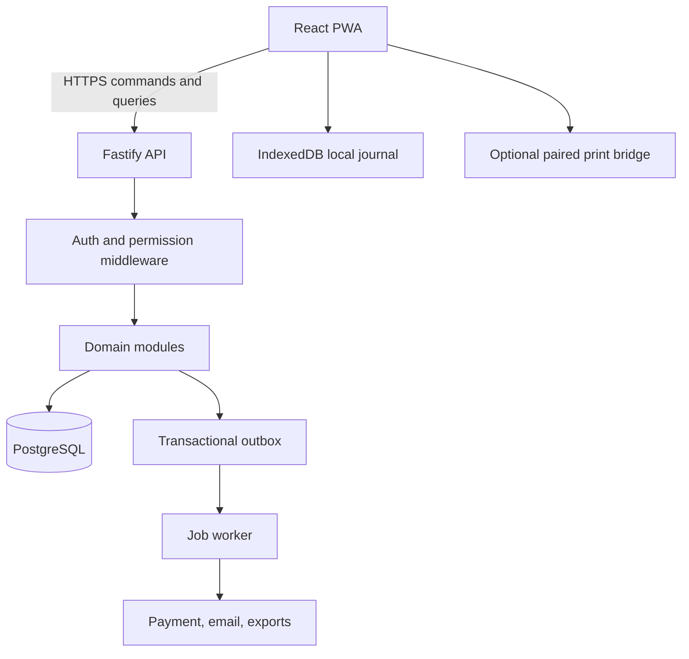

# MAZAO ERP — CONSOLIDATED MASTER SPECIFICATION

Generated from modular pack; individual files are authoritative sections.


---

# docs/01-PRODUCT-PRD.md

# Product requirements document

## Mission and product promise
Mazao ERP helps businesses operate with less training, fewer mistakes and trustworthy real-time understanding. Its tagline: **Run your business. Not your software.** This is an independent new brand/product, initially optimized for Kenya and East Africa, internationalizable from the start. Core verticals: retail counters, restaurants/cafes, bars/lounges, hotels/guest houses, resorts and mixed sites.

## Product design laws
1. Show actions, not database entities. 2. Advanced controls are progressive, never mandatory for elementary work. 3. No silent double-posting or deceptive success state. 4. Every important total can be traced to source records. 5. Offline is visible and bounded. 6. Physical operator actions should match physical goods. 7. Support actual constrained terminals. 8. Permission-aware, capability-aware navigation. 9. Accessible without assuming perfect literacy or broadband. 10. Immutable business evidence with authorized reversals.

## Personas/jobs to be done
| Persona | Landing tasks | Success criterion |
| --- | --- | --- |
| Cashier | Sell, tabs, pay, reprint, shift | Fast unambiguous checkout, no duplicate tender |
| Waiter | Tables, orders, fire ticket | Correct station receives each order exactly once |
| Cook/Bartender | Tickets, preparation, ready | Clear route, timestamps and modifications |
| Storekeeper | Receive, count, move, waste | Quantities and discrepancies explained |
| Receptionist | Arrivals, availability, checkout | No overlapping room allocations |
| Housekeeper | Clean, inspect, defects | Rooms transition through controlled statuses |
| Accountant | Payments, tills, journals, periods | Balanced books, source traceability |
| Owner | Today, trends, margin, exceptions | Correct figures and timely alerts |
| Administrator | Configure, staff, devices, imports | First-use setup without developer intervention |

## Business capability packs
**Commerce:** catalog, baskets, discounts, taxes, payments, customers, credit, returns, receipt. **Food service:** tables, tabs, modifiers, tickets, recipes, routing, kitchen. **Inventory:** units/packages, locations, movements, sealed/open containers, physical counts. **Purchasing:** suppliers, PO, deliveries, invoices, payable, asset acquisition. **Hospitality:** rooms, availability, reservations, stay, folio, deposits, services, housekeeping. **Finance:** journals, chart of accounts, expenses, closing, reconciliation, P&L. **Operations:** staff, shifts, assets, maintenance, audit, reports, exports. Advanced capabilities hidden when disabled.

## In-scope v1 / deliberately deferred
**v1:** one tenant can have several outlets, roles/devices; online POS, confirmed/manual M-Pesa, cash, receipts, product import, stock movements, purchasing essentials, room walk-ins/reservations, guest billing, shift cash-up, basic accurate finance and operator-specific reporting, offline cash with safe capability model where accepted. **Later:** automated M-Pesa integrations, eTIMS integrations subject to verification, loyalty, public booking engine, advanced payroll, native apps, AI insights, reseller billing, sophisticated revenue management. All future modules must fit existing core boundaries without expanding the v1 release gate.

## Workflow-level acceptance
- Fresh tenant: admin account → business/outlet → settings → stock items/import → staff/permissions → test sale → opening shift → go live.
- Counter: select item → total → tender → confirmed receipt; refresh/retry cannot make a second payment.
- Restaurant: table → order → fire items → station ticket → complete → split or settle; stock and accounts post only at documented event boundaries.
- Stock: receive 4 six-packs → 24 cans counted; scan barcode → stock count draft survives reboot → signed variance posting.
- Hotel: walk-in → room occupancy locks → add food to room → partial payment → checkout reconciles guest balance → room enters cleaning queue.
- Finance: money movement balances, period report shows completeness/freshness, drill-through source.
- Offline: valid pre-issued grant and device persistence allow allowed local cash operations; reconnection replays original IDs, never duplicate.

## Business success metrics
Time-to-first-sale, new staff time-to-first-completed checkout, sale tap latency p95, count completion time, payment recovery success, closing discrepancy rate, daily support requests per outlet, offline replay duplicate count (target zero), tenant provisioning time, restore rehearsal success. Instrument without leaking cardholder or sensitive personal data.


---

# docs/02-UX-DESIGN-SYSTEM.md

# UX, UI and interaction specification

## Information architecture
Top-level actions by context: **Today**, **Sell**, **Stock**, **Hotel** (only enabled), **Money**, **Manage**, **Help**. Avoid cross-domain maze. Context menu changes for cashier, waiter, kitchen, storekeeper, receptionist, housekeeper, finance, manager, owner and admin. Roles enforce server permissions; frontend hiding is only visual, not security.

## Layouts
POS terminal 1024x600 / 1280x720: search + category/product grid + pinned basket + pinned payment CTA, keyboard shortcuts and scanner focus. Tablet landscape 1280x800; portrait 800x1280; management 1366x768 and 1920x1080; phone 390x844 with stack/navigation. Zero horizontal clipping on primary tasks. Keep primary action visible on small heights. Respect reduced motion and high contrast.

## Visual direction
Warm, intelligent, calm, premium; use restrained neutral surfaces and a distinctive botanical/accent palette (final colors must be accessibility-tested). Typography high-legibility, 8pt spacing rhythm, minimum 44px touch targets where appropriate, clear visual state. Design tokens: semantic surface/text/border/accent/warning/success/danger, spacing 4/8/12/16/24/32, radii 6/10/16, elevations minimal. No meaning conveyed by color alone.

## Shared component catalogue
AppShell, WorkspaceNav, QuickAction, SearchCommand, ProductTile, BasketLine, PaymentSheet, MoneyInput, DataTable, FilterBar, SummaryMetric, ChartWithDrilldown, SmartItemWizard, PackagingEditor, StockCountSession, ApprovalSheet, PermissionGate, StatusNotice, ErrorRecoveryPanel, OnlineStatus, ConfirmDialog, UnsavedChangesGuard, EmptyState, Skeleton, PrintPreview, ImportColumnMapper, ConflictDiff, HelpDrawer. Storybook or equivalent documented visual catalog and semantic tests for each component.

## Critical interaction states
`IDLE → EDITING → VALIDATING → SENDING → CONFIRMED | REJECTED | OUTCOME_UNKNOWN | LOCAL_ONLY | CONFLICT`. Unknown outcomes never clear the form or create a new command ID. Recovery dialog supports `Check status`, `Review activity`, `Edit after explicit rejection`; not an unreachable button behind the overlay. Offline states distinguish **Saved draft**, **Locally committed**, **Pending sync**, **Server confirmed**.

## Microcopy and terminology
Prefer Item (not stock master), Count stock (not inventory.countLocation), Guest bill (not folio in basic UX), Receive delivery (not GRN as only action), Checking save status (not OUTCOME_UNKNOWN), This changed on another device (not conflict 409). Use Kiswahili localization later via i18n catalog; do not embed copy into domain logic.

## Task-oriented walkthroughs
Contextual help answers "I want to sell", "How to add a product", "Why is payment pending?". First-use walkthroughs do not block action. For risky actions, explain consequence in plain language and require authorization when configured.

## Research and sign-off
Prototype with at least cashier, storekeeper, receptionist, owner. For every critical journey measure screens, taps, mistaken paths, recovery clarity and elapsed task time. Use a11y automated + manual screen reader, keyboard and touch tests. Visual snapshot across required viewport matrix.


---

# docs/03-PLATFORM-ARCHITECTURE.md

# Platform and solution architecture

## Architectural style
One TypeScript monorepo; a modular monolith API with domain modules; separate worker process using the same domain package and PostgreSQL; statically hosted React PWA; optional minimal print-bridge binary. PostgreSQL owns committed shared state. No direct browser database access. Begin on one VPS or cloud provider behind TLS reverse proxy with containers; move to managed Postgres/independent API instances when traffic justifies it.

## Logical data flow


## Vertical modular boundaries
`identity`, `tenancy`, `configuration`, `catalog`, `inventory`, `commerce`, `hospitality`, `procurement`, `accounting`, `staff`, `assets`, `reporting`, `integration`, `offline`, `audit`. Modules export domain commands/queries, not internal table access. Cross-module coordination only via orchestrated application transaction and post-commit domain events. Never publish an event that assumes a transaction succeeded before commit.

## Code topology
```text
mazao-erp/
  apps/pwa/              React UI, worker, IndexedDB
  apps/api/              HTTP adapter, auth, openapi, bootstrap
  apps/worker/           background tasks and integrations
  apps/print-bridge/     OPTIONAL standalone native service
  packages/contracts/   canonical versioned schemas and generated API types
  packages/domain/      invariant-focused domain/application services
  packages/db/          migrations, queries, unit of work
  packages/design/      accessible UI components/tokens
  packages/offline/     local ledger and reconciliation logic
  packages/testing/     fixtures, builders and contract harness
  infra/                containers, ingress, CI, backups
  docs/                 versioned specs and ADRs
```

## Transaction topology
Commands enter idempotency gate, validate actor+tenant+device, then domain service executes within a PostgreSQL transaction and records immutable audit/event and command result. Read models can be updated synchronously if necessary for immediate checkout correctness, or through an idempotent outbox consumer for eventual analytics. Use `SELECT ... FOR UPDATE`/concurrency versions on contested inventory/room/till records. External side effects (SMS, provider requests, actual print) are handled after commit via outbox and retries.

## Time and money
All persisted timestamps UTC with IANA timezone per tenant/outlet for rendering and business-day boundaries. Money stored as integer minor units (`BIGINT`) with ISO currency code, never binary floats. Quantity stored as decimal numeric/scaled integer with unit dimensions. Do not use JavaScript Date logic alone to define room-night or accounting-period boundaries; document local timezone business rules and DST tests even if initial deployment is Nairobi.

## Evolution
PWA and API version independently with explicit protocol compatibility. Add replicas, CDN and horizontal API later. Extract worker integrations or reporting only when observed load or independent scaling demands it. No dual-authority local SQLite vs PostgreSQL architecture for this greenfield system.


---

# docs/04-DOMAIN-MODULES.md

# Domain modules and invariants

## Tenancy and configuration
Organizations have locations/outlets, staff memberships, feature capabilities, fiscal settings, time zone, currency, receipt profile. Tenant-scoped uniqueness and queries mandatory. Feature switching changes UI and policies, not the underlying database lineage.

## Sales and service
Sale draft, order lines, modifier selections, service routes, ticket sent state, price/tax snapshots, tenders, split payments, discounts, voids, refunds and immutable receipt documents. Committed line's price snapshot never recomputed from changing product prices. Tab/table transfer must lock both orders and preserve history. Paid order may only be amended through explicitly auditable adjustment/refund paths.

## Stock and catalog
Product family and variants; purchase packages and multiple barcodes; inventory items with canonical unit; stock locations; reservations; sealed containers/open volumes; ingredient recipes and yields; movement ledger. Available = physical - reserved - outstanding provisionally committed allocations (never double-subtract same pending movement). Count corrections are movements with reasons, never silent `UPDATE quantity`.

## Purchasing and supplier accounts
PO draft/approved/ordered; delivery reception; rejected goods; supplier invoice; tax/cost allocation; three-way matching; AP balance and settlement. Receiving creates stock/valuation and payable or GRNI policy, not supplier cash expense. Reject duplicate supplier invoice reference per supplier/tenant.

## Hotel lifecycle
Room types, rooms, rates, availability, reservations, check-in, stay, guest bill, deposits, charges, room moves, checkout, housekeeping and maintenance hold. Overlapping confirmed reservations/stays require correct concurrency guard. Walk-in can be created without a mandatory marketing customer profile; legal guest requirements remain configurable and locally reviewed.

## Money and accounting
Tills, movements, cash-up, payments, customer account balances, supplier account balances, recognized revenue, cost of goods, chart of accounts, balanced postings, period close, adjustments. `settled` is not inferred from "print receipt" or external collection promise.

## People and assets
Staff memberships, permissions, time-bound manager approvals, device register/revoke, shifts, assets acquisition/custody/maintenance/disposal, immutable audit trail. General users must not see administrator workspaces.

## Reporting
Sales/returns, tender mix, shift, stock valuation/movement, gross margin, purchases/AP, guest balances, ADR/occupancy, financial statements and exceptions. Reports show as-of and coverage indicators, plus drill-down. Zero differs from unavailable or incomplete.

## Command manifest requirement
Every domain operation entry: `name`, input/output JSON Schema, minimum permission, approval, isolation/locking, online/offline mode, side effects, audit event, idempotency key scope, unit and integration acceptance tests. Generated contract catalogue is CI-gated.


---

# docs/05-DATABASE-MODEL.md

# PostgreSQL schema and persistence specification

## Conventions
Primary IDs UUID/ULID (choose one and apply consistently); `tenant_id` on all tenant-owned rows; append-only immutable financial and inventory evidence; `created_at`, `updated_at`, `created_by`, optional `version BIGINT`, strict FK and indexed tenant-scoped lookups. Logical deletion only for non-transactional master data. Use schema migrations, never ad hoc production DDL. Migration checksums are immutable after deployment.

## Core aggregate tables
| Domain | Primary tables |
|---|---|
| Identity | users, organizations, memberships, roles, role_permissions, devices, approval_grants, sessions |
| Organization | outlets, stock_locations, business_settings, feature_entitlements, receipt_profiles |
| Catalog | product_families, product_variants, prices, barcodes, purchase_packages, tax_classes, recipes, recipe_ingredients |
| Inventory | stock_items, stock_balances, stock_movements, stock_reservations, sealed_containers, open_container_balances, stock_counts, count_lines, stock_transfers |
| Commerce | orders, order_lines, tickets, ticket_lines, payments, payment_allocations, refunds, till_sessions, till_movements, receipt_documents |
| Hospitality | room_types, rooms, rate_plans, reservations, stays, guests, folios, folio_entries, housekeeping_tasks, room_blocks |
| Procurement | suppliers, purchase_orders, po_lines, goods_receipts, grn_lines, supplier_invoices, accounts_payable, supplier_settlements |
| Finance | accounts, journal_entries, journal_lines, accounting_periods, expenses, reconciliation_runs |
| Ops | employees, assets, asset_events, maintenance_work_orders, attachments, imports, import_rows |
| System | commands, command_outcomes, change_feed, transactional_outbox, worker_attempts, audit_events, offline_grants, device_sequences |

## Mandatory constraints/indexing
Tenant FK consistency (do not accept cross-tenant referenced IDs), uniqueness `(tenant_id, sku)` and `(tenant_id, barcode)` where active, `(tenant_id, client_command_id)` idempotency, `(tenant_id, outlet_id, business_date)` for daily reports, and `(tenant_id, device_id, sequence)` for local command replay. Prevent duplicate payment provider references within the appropriate merchant/account scope. Journal postings must be balanced per currency and journal entry; validate under serialized posting transaction. Nonnegative quantities where policy forbids negative stock, using locks/version checks rather than naive read-then-write.

## Authorization model
API enforces tenant scope for every query and mutation, plus business permission. Optionally enable PostgreSQL RLS as defense in depth; never rely solely on RLS or assume ORM tenant filters are sufficient. Service credentials cannot reach frontend. Employee membership is not a global business-wide privilege.

## Versioning and migration
Add-only expansion migrations preferred; feature flags for changed behavior; compatibility between N and N-1 deployed client protocols for a defined window. No drop/rename until consumers migrated and verified. DDL tested against empty DB and real-shaped sanitized fixture backup. Large tables: indexes concurrently where supported; document lock impact.

## Recommended schema groups
`identity`, `core`, `catalog`, `inventory`, `sales`, `hospitality`, `procurement`, `finance`, `ops`, `system`. Do not create a giant generic JSON documents table as the primary store for critical financial transactions. JSONB acceptable for noncritical user settings, typed metadata and snapshots alongside relational columns.

## Derived values
Stock on hand and customer balance are derived from immutable evidence, with transactional materialized/current-balance table for fast reads. Reconciliation must recompute balances and prove equality. Historical costs from movements/sale consumption snapshot, not mutable current product cost.


---

# docs/06-API-CONTRACTS.md

# API and command protocol

## Transport
HTTPS JSON REST + incremental change feed; OpenAPI generated from source-checked schemas. Prefix `/api/v1`; no browser direct SQL/RPC, no public internal admin endpoints. All write paths accept stable client idempotency identifier. Support SSE/WebSocket notification as optional wake-up only; authoritative changes are pulled by cursor.

## Canonical envelope
```json
{
  "commandId":"018f...", "protocolVersion":1, "tenantId":"...", "deviceId":"...",
  "type":"sales.order.settle", "expectedVersions":{"order:...":7},
  "occurredAt":"2026-10-13T16:00:00.000Z", "payload":{"orderId":"...","tenders":[{"method":"CASH","amountMinor":170000,"currency":"KES"}]}
}
```
`tenantId` in body is advisory only and must match authenticated context; never accept as authorization. Server transaction inserts command record with unique `(tenant_id,command_id)` and request hash, refuses replay with same ID/different payload, executes once, persists deterministic outcome and feed event. Retrying exact ID returns original outcome without reposting. Scoped optimistic `expectedVersions` only for resources actually touched.

## Response
```json
{"commandId":"018f...","status":"CONFIRMED","serverSequence":1234,"result":{"orderId":"...","receiptId":"..."},"changed":[{"collection":"orders","id":"...","version":8}]}
```
Statuses: `CONFIRMED`, `REJECTED`, `CONFLICT`, `OUTCOME_UNKNOWN` (client-local interpretation when response lost), `REQUIRES_ONLINE`, `REQUIRES_APPROVAL`. Error taxonomy: `VALIDATION_FAILED`, `UNAUTHORIZED`, `FORBIDDEN`, `NOT_FOUND`, `VERSION_CONFLICT`, `INSUFFICIENT_STOCK`, `RESOURCE_OCCUPIED`, `LIMIT_EXCEEDED`, `CAPABILITY_EXPIRED`, `IDEMPOTENCY_MISMATCH`, `PROVIDER_PENDING`, `INTERNAL_ERROR`. Human-facing mapping belongs in UI.

## Endpoints
- `POST /api/v1/auth/login` (or OIDC completion), `/auth/refresh`, `/auth/logout`, `/auth/me`.
- `POST /api/v1/commands` server-authoritative domain mutation.
- `GET /api/v1/commands/:id` status check, permission scoped.
- `GET /api/v1/sync/changes?cursor=...&limit=...` ordered tenant/device-authorized feed; opaque monotonic cursor, paginated.
- `GET /api/v1/bootstrap` initial scope snapshots with checksum, schema version, cursor; large bootstrap streamed/chunked.
- `GET /api/v1/catalog/items`, `/orders/:id`, `/inventory/locations/:id`, `/hospitality/rooms`, `/reports/*` focused read projections.
- `POST /api/v1/devices/enroll`, `/devices/:id/revoke`, `/offline/grants`, `/imports/validate`, `/imports/apply`.
- `GET /health/live`, `GET /health/ready`, `/metrics` only on protected/private network for internals.

## API safety
Pagination, bounded payload, rate limiting, schema validation, permission on every handler, opaque cursors, request IDs. Do not leak stack traces or personal data. API responses include `ETag` where suitable, stable error codes, as-of metadata. Breaking changes require new contract version and consumer matrix.

## Command tests
Replay exact ID, same ID/different hash, concurrent sale of last item, concurrent room claim, user unauthorized, device revoked, manager approval consumed twice, server committed/request timed out, stale expected version, same cash settlement repeated after restart. All must be deterministic.


---

# docs/07-OFFLINE-SYNC.md

# Offline-first transactional protocol

## Principle
A cached PWA is not automatically an offline-capable ERP. Offline financial operation requires durable local state, authenticated device identity, bounded rights, replay deduplication, reconciliation, storage resilience and clarity about unsettled provider transactions.

## Local stores
IndexedDB stores tenant-scoped local projections, schema version, sync cursor, immutable local commands, local outcome records, pending print jobs, cash shift/ledger, draft orders, offline capability, projection hashes, device counters and backup-export metadata. IndexedDB version migrations must be atomic, staged and tested across active releases. Service Worker caches app assets, not credentials or privileged API responses indiscriminately.

## Offline grant
Online server issues short-lived signed capability binding tenant, outlet, actor, device public key/fingerprint, permitted command types, maximum aggregate cash exposure, per-operation limits, optional order/stock/room allocations, sequence interval and expiration. Verify signature and expiry locally; server fences revoked grants and validates remaining allocations during replay. Define predictable behavior when a grant expires during outage. Online-only operations include provider-verified settlement, unrestricted supplier payment, broad administrative changes, final period close and any unallocated shared-resource reservation.

## Sale lifecycle
`DRAFT → LOCAL_PREPARED → LOCAL_COMMITTED → PENDING_SYNC → SERVER_CONFIRMED | RECONCILIATION_REQUIRED | REJECTED`. Persist local cash evidence before telling cashier local sale is complete. Receipt marked as locally issued until server confirmation and must retain original ID/reference; reprinted copy marked copy. Failed server replay must not silently erase cash collected.

## Sequence and replay
Per-device monotonic sequence with stable command UUID and append-only record. Replay preserves original ordering where dependent, hashes original payload and sends exact original ID. Server returns stored outcome for duplicates and rejects gaps/sequence conflicts as policy requires. Pull feed updates local projections idempotently and cursor advances only after durable apply. `OUTCOME_UNKNOWN` requests status for original ID, never fabricates retry with new ID.

## Multi-device conflict policy
Online: PostgreSQL grants single authoritative settlement; rooms/stock/till lock. Offline: only allocated/reserved resource rights may finalize local operations that compete globally. For v1 allow cash counter sales subject to availability/limit policy, and drafts for other unsafe operations. Inventory counting may persist offline as evidence but authoritative adjustment waits for server conflict review. No claim that an offline room is exclusively reserved without a lease/allocation. Never manufacture M-Pesa success while offline.

## Browser/device loss
Warn against private browsing, storage cleanup and switching browsers. Request persistence where available, monitor storage quota, export encrypted recovery package containing pending local evidence and projections but not reusable authentication secrets. Do not cache long-lived signing secrets in plain storage. Native print bridge is not a duplicate source of financial authority. Optional device escrow/recovery methods must consider revocation and privacy.

## Acceptance
100 permitted offline cash sales, refresh/restart between arbitrary writes, replay 5 times, mixed success/timeouts, local migration interruption, expired/revoked grant, lost IndexedDB, two devices competing, restored export to different enrolled device (fenced until authorized). No unexplained double payments, no invisible loss of locally collected cash.


---

# docs/08-AUTH-SECURITY.md

# Security, identity and privacy

## Threat model
Tenant cross-access, stolen staff PIN, reused operator session, compromised kiosk browser, malicious CSV/QR, forged offline grant, forged print-job origin, replay/double tender, privilege escalation, stale client, backup theft, exposed API tokens, worker privilege, injection, and supply-chain compromise.

## Identity
Prefer reputable OIDC or hardened first-party identity with modern password hashing, secure server sessions, optional passkeys/MFA for admins and financial roles. Staff fast-switch PIN is a short local operator re-auth step scoped to enrolled device and provisioned session, not a global login credential; throttle attempts and centrally revoke. Web sessions secure `HttpOnly; Secure; SameSite` cookies where possible with CSRF protection and explicit CORS allowlists. Rotate refresh tokens and revalidate permissions for sensitive actions.

## Permissions
Deny-by-default granular RBAC plus ABAC checks on tenant, outlet, device, shift, ownership, approval, operation amount, and offline capability. Manager approval is short-lived, action+target+amount-bound, single-use and audited. Never accept arbitrary approval UUID from user without server lookup/validation. Separate vendor superadmin plane from tenant operator/admin plane.

## Tenant separation
Scope all reads/writes by server-derived tenant membership, including imports, reporting and search. Composite tenant FKs, test deliberate cross-tenant IDs for every route. DB connection users least-privilege; audit bypass paths. PII/guest information minimized and retained according to approved local policy; include subject access/export and retention workstream.

## Data protection
TLS 1.2+ configured to current standards, keys in secrets manager or root-owned environment, not Git. At-rest encryption on server/backups; protect locally stored operational data, lock kiosk profiles, minimize card data. Never store payment card PAN/CVV. Receipt QR uploads sanitized, image limits and allowlisted MIME; SVG only after sanitization or reject. CSV formulas neutralized on export. Attachment virus scanning where practical.

## Software supply chain
Pinned dependency lockfile, audit policy, secret scanners and SAST, SBOM, signed build provenance, protected branches, reviewed migrations, no production credentials in CI logs. Scheduled penetration and disaster recovery exercises. Align controls with current OWASP ASVS and verify against actual standards at implementation time.

## Audit
Append-only evidence for login, financial posting, stock correction, refund, permission change, device enrollment/revocation, offline lease, import apply, period close, and admin access. Audit retention and access restrictions. Hash chain optional defense, not a substitute for restricted DB permissions and offsite records.

## Security release gates
Authorization tests across tenants/roles, API fuzz/schema negative tests, CSRF/CORS, session expiration, offline grant forgery, replay attacks, print bridge origin validation, upload sanitization, secret scan, backup recovery encryption and annual policy review.


---

# docs/09-FINANCE-ACCOUNTING.md

# Accounting and financial integrity specification

## Accounting policy
Double-entry general ledger from inception; balanced journal entries by currency; immutable posted entries and controlled reversing/adjusting entries. Chart of accounts configurable with template for small Kenyan hospitality/retail operators. Distinguish payment collection, accounts receivable/payable, revenue recognition, COGS, inventory asset, tax liability, customer deposits, discounts, refunds and cash drawer movement.

## Example events
Cash sale KES 1,700 inclusive tax: Dr Cash KES gross; Cr Sales Revenue net; Cr Tax Payable appropriate amount as determined by configured tax policy. Simultaneously Dr COGS and Cr Inventory at recorded actual cost. **Never hardcode tax rate**; tax classification and invoice rules must be verified per business and effective date. Credit sale uses Accounts Receivable rather than cash. Hotel advance deposit posts Cash vs Customer Deposit Liability until earned or policy-defined recognition. Supplier purchase: receive inventory against AP/GRNI as policy dictates; supplier payment Dr AP / Cr Cash or Bank, not an operating expense at payment time.

## Financial subledgers
Payment transactions and allocations, tills, cash paid in/out, supplier liabilities, guest bill charges, customer credit, stock cost evidence, expenses, asset depreciation. Each subledger event references a journal source ID unique within tenant. Close process calculates trial balance and reconciles to operational sources.

## Period controls
Period states `OPEN`, `CLOSING`, `CLOSED`; closed period rejects ordinary backdated postings. Approved adjustment routes have explicit effective date, audit and posting policy. Trial balance must be zero difference, unmatched receipts and provider transactions flagged, cash shift difference explained. No silent rewrite of prior invoice or receipt.

## Reports
P&L includes recognized revenue, returns, discounts, COGS, gross profit, payroll/accrual/expenses, depreciation, finance costs, applicable taxes depending on statement. Financial position statement only once complete account coverage is operational. Every figure drill-through to original journal entries. Incomplete data produces "partial operating summary" not "net profit". Tax/eTIMS compliance is a separately verified integration project, never claimed by generic receipt generation.

## Invariants/tests
Every posted journal balances; double refund can't exceed original remaining reversible amount; payment allocation cannot exceed cleared/confirmed tender; negative cash from counted drawer requires explicit policy; no period close with unexplained imbalance; duplicate provider callback creates one settlement; historical sale margins use cost snapshot; deposit is liability until earned.


---

# docs/10-POS-INVENTORY.md

# Commerce and inventory design

## POS workflows
Dedicated fast cashier workspace. Favorite/categories/search/scanner, portion/modifier selection, quantity +/- controls, discounts/comp approval, held order, open tab, table/guest charge, split tender, refund and printable immutable receipt. Product tap renders within target 100ms p95; durable command state shown separately. No full data refresh for each tap. Store local draft as first-class object distinct from server-accepted order.

## Product model
One Item Wizard handles packaged drink, portioned spirit, wine, ingredient by weight/count, cooked dish, retail good, service. User describes **Buy → Count → Sell/Use**. Internal item ↔ product variants ↔ stock item ↔ locations ↔ packages ↔ recipes created atomically. Every barcode maps to unit and multiplier. Price input explicitly says per pack vs per unit, with visible calculated total, loss warning and confirmation.

## Packaging example
Coke single=1 can, six-pack=6 cans, case=24 cans. Four packs @ KES 900 per pack yields 24 units at KES 150 per can and KES 3,600 inventory receipt before any extra charges. Unit conversion dimensional guard forbids grams→milliliters without specific density.

## Open-container example
Whisky 750mL may sell 30mL, 60mL, or sealed 750mL. Maintain sealed container count and opened usable volume per location. Whole-bottle sale consumes sealed container; shot consumes open volume and can atomically open sealed container when policy allows. Do not allow total volume to stand in for commercial sealed availability. Record breakage/waste and reconciliation measurements.

## Food recipes
Recipe version has ingredient quantities with units, yield, waste assumptions and costing; production/batches move raw ingredients to prepared stock if configured. Actual stock consumption uses an explicit trigger (e.g., fired/fulfilled) and cannot double-consume on payment retry. Portion cost snapshots feed financial COGS.

## Inventory count
A durable location count session stores baseline revision, scanned lines, unknown barcode queue, counted quantity, review status and actor. Unknown barcodes require resolution before final review. Submit complete count as one atomic reviewed command; spot count is a separate command with different semantics. Audit before/after delta, reason, approval and costs. Never directly overwrite balances.

## Stock availability
Display physical, reserved, pending local, available. Distinguish local provisional position from server authoritative position. Concurrency locking protects selling remaining stock and reconciling offline reservations.


---

# docs/11-HOSPITALITY.md

# Rooms and guest operations

## Core entities
Room type, room, rate plan with effective dates, reservation, rate quote, guest, stay, guest bill/folio, guest payment/deposit, housekeeping task, room block and maintenance. A stay can have minimal guest identity per local/legal policy; booking website account is never mandatory for walk-in. Room pricing is a server-side snapshot with effective rate, tax policy and duration rules.

## Flows
**Walk-in:** availability → choose room/rate/dates → optional guest details per law/policy → check in atomically → create guest bill → room becomes occupied. **Reservation:** quote availability → hold/reserve with expiry and concurrency → confirm/deposit → no overlapping occupancy. **During stay:** post service/room charge, transfer eligible POS charges once, receive deposit/payment, move room with traceability, extend if available. **Checkout:** show all charges/payments/refunds → settle or record approved remaining balance → close guest bill → mark room dirty/cleaning needed → produce guest statement. **Housekeeping:** dirty→cleaning→inspected→ready; maintenance hold prevents assignment.

## Key invariants
A room cannot be assigned to overlapping active stays; race-safe transaction with exclusion strategy or locks; event boundaries and timezone semantics explicit; a room move changes allocation not historical bill identity; folio reversals link to original entry and do not erase history; deposits vs earned room revenue distinguished; guest bill and journal postings reconcile.

## Dashboard
Arrivals, departures, checked-in guests, available/occupied/dirty/out-of-service, room blocks, unsettled balances and today's occupancy. Managers have rate/room setup; front desk sees operational tasks only.

## Acceptance matrix
Same room race across two devices, cancellation vs check-in race, early/late checkout, day stay, rate-plan validity and tax, move between rooms, multiple payment methods, offline draft while occupancy cannot be safely asserted, refund and reopen policy, room maintenance hold, hotel-only tenant with POS disabled.


---

# docs/12-HARDWARE-PRINTING.md

# Printing, scanners and hardware

## Modes
1. Universal HTML/CSS print dialog with explicit 80mm print profile and preview. 2. Dedicated kiosk-browser printing for verified controlled hardware. 3. Optional paired local Mazao Print Agent for silent/RAW ESC/POS and local queue recovery. The print agent is not an inventory, order or payment server.

## Print job contract
`jobId`, `tenant`, `device`, `documentId`, immutable document version, printer profile, copy type, content hash, issue time and expiry, signature/auth context. Agent listens on localhost or narrowly scoped TLS LAN endpoint, verifies allowed origin, bound device and job authorization. No arbitrary shell commands or unrestricted RAW byte submission from browser; render validated structured receipt or bounded image asset.

## Print lifecycle
`CREATED → QUEUED → SENDING → SENT_TO_SPOOLER → CONFIRMED_BY_DEVICE (if hardware supports) | DELIVERY_UNCERTAIN | FAILED | CANCELLED`. Spool acceptance is NOT proof of physical paper. On ambiguous interrupted send, require staff acknowledgment before reprint; mark duplicate/copy. Jobs stable ID and de-duplicated when known unsent.

## Receipt content
Merchant/trading details, outlet, operator where allowed, immutable order/receipt reference, timestamp/timezone, rows, quantities, tax and tender breakdown, paid/remaining/change, logo, optional M-Pesa till QR immediately before footer, footer branding, customer/business copy marker. Thermal profile honors printable width and margins; support 58mm and 80mm independently after device acceptance. Logos and customer-provided QR PNGs share bounded image resize/monochrome raster path, but validate scannability before acceptance; never claim QR is verified just because raster generated.

## Peripheral acceptance
USB HID keyboard wedge scanner scan-to-search and count; unknown barcode; repeat burst scans. Ethernet/USB 80mm thermal test on Windows, print queue interruption, driver restart, cutter, partial roll, QR margins; tablet browser print fallback. Cash drawer kick only through explicit authorized command, and only when hardware physically supported.


---

# docs/13-INFRA-DEPLOYMENT.md

# Production infrastructure and deploy model

## Environments
Local developer Docker; isolated CI ephemeral PostgreSQL; staging separate DNS/database/keys; production separate credentials, backups and deployment permissions. Do not let staging migrations or OAuth callbacks target production. Illustrative DNS: `app.mazao.example`, `api.mazao.example` until the brand controls a real domain. Avoid claiming a domain is registered.

## Initial topology
Nginx HTTPS ingress → static hashed PWA assets + Fastify API on internal listener → private PostgreSQL; private worker consumes transactional outbox. Container network private, database not exposed publicly. Start single-node VPS with external offsite backup; introduce managed DB and more API nodes as traffic and RTO require. Port assignments parameterized to avoid conflicts with co-hosted services.

## Containers
API and worker from same immutable source digest; DB pinned supported major/minor after compatibility tests; health/readiness endpoints; nonroot users; readonly root FS where possible; resource caps; restart policies; no `latest` tag. Postgres volume separate from application release. Deployment examples under `infra/` are templates, not verified production manifests.

## CI/CD stages
1. Format/type/lint/contracts. 2. unit/domain/property tests. 3. migration fresh + upgrade. 4. API integration. 5. offline failure tests. 6. browser desktop/tablet/mobile. 7. a11y + visual regression. 8. supply-chain/secret checks. 9. build signed/pinned images and static PWA release. 10. deploy staging + smoke. 11. human approval prod. 12. online readiness, exact release evidence and canary. 13. rollback runbook. No deployments from local uncommitted files.

## Database upgrades
Backup + verified restore checkpoint. Expand schema first, deploy backward-compatible API, then PWA, migrate data in controlled job, contract schema only after compatibility window. Never downgrade database blindly via reverse SQL. Roll back binary to compatible previous API when safe; if schema requires restoring backup, perform explicit full data-loss/reconciliation review.

## Resource guidance
First hardware sizing requires load testing; do not assert fixed capacity. Start modest (e.g., 2–4 vCPU, 4–8GiB RAM) and verify against real customer mix. PostgreSQL RAM/IOPS, connection pool and backup footprint dominate decisions. PWA uses CDN/static caching. Keep database storage encrypted and monitored; no public admin port.


---

# docs/14-OBSERVABILITY-OPERATIONS.md

# SRE, backups and service operation

## Telemetry
Structured logs with request ID, tenant surrogate ID, actor/device non-sensitive identifiers, command ID, outcome, latency, exception family and deployment SHA. Never log authentication tokens, guest ID documents, payment credentials or raw CSV. Metrics: API p50/p95/p99, error classes, DB connections/locks, worker backlog, outbox age, sync cursor lag, offline pending and conflict counts, successful print spools vs uncertain sends, backup age, restore age, disk/memory, business transaction reconciliation failures. Trace commands end-to-end across API/worker.

## Reliability targets (proposed)
99.9% monthly server availability after beta; API success p95 under 300ms excluding provider round trips and large report queries; cashier visual tap p95 under 100ms on accepted device; zero unexplained duplicate confirmed payment; zero journal imbalance; zero stock negative beyond policy; nightly offsite backups plus PITR if selected; RPO goal 15 minutes / RTO goal 4 hours subject to funded architecture and rehearsed acceptance. Record the exact achieved figures before sales claims.

## Alerts
Page on no recent verified backup, restore check failed, critical API error rate, DB nearing disk limit, corrupt migrations, unbalanced journal, unhandled worker dead-letter, multiple tenants affected. Business exception alerts stay in tenant manager inbox rather than paging developers by default.

## Backups
Automated encrypted PostgreSQL backups + optional WAL/PITR, off-host object store with immutable/retention protections, secrets separate from dumps; restore to isolated instance and compare control totals monthly; quarterly full service failover drill. Export tenant business data through permissioned APIs without exposing other tenants. Never put only backup beside production DB on same VPS.

## Incident process
Incident commander, severity tiers, audit evidence, customer communication, containment, timeline, restore test, reconciliation, postmortem. Dedicated runbooks: outage, compromised user/device, stuck sync, payment unknown, print uncertain, stock corruption, room double allocation, expired TLS, disk exhaustion and credential rotation.


---

# docs/15-TESTING-ACCEPTANCE.md

# Verification matrix and release acceptance

## Test pyramid
Unit tests for pure conversion, money/tax rounding, rates, commands; property-based invariants for quantity/money; contract tests generated from operations manifest; Postgres integration transaction/race tests; HTTP permission and tenancy tests; Playwright end-to-end across role and viewport; optional hardware-in-loop; backup/restore and rollout drills.

## Critical acceptance suites
A. First use: empty database tenant creation, import, outlet, staff, stock, first sale, print, close shift. B. POS: rapid 50-product scan, split tender, mixed tax, void and refund, failed network response, duplicate replay, kiosk browser restart. C. Inventory: multi-level packaging, sealed/open, count draft persistence, unknown barcode, count vs sale concurrency, transfer/waste. D. Hotel: competing same-room requests, walk-in, deposit, service room charge, partial checkout, housekeeping. E. Finance: every journal balances, source reports reconcile, refund and supplier partial pay, period closure and late entries. F. Security: tenant ID swap, role escalation, lost device, forgery/revocation of grant, malicious CSV, approval replay. G. Offline: 100 permitted cash sales with interrupted sync, local migration, double replay, multiple devices. H. Infrastructure: first deploy, rolling API rollback, DB upgrade, offsite restore.

## Gate definitions
`GREEN` means all mandatory tests pass on exact commit/build SHA; `HARDWARE_PENDING` documents untested printer but does not describe physical printing as accepted. No false claims about M-Pesa provider authorization, tax certification, or financial reporting where data incomplete. Physical production acceptance signed per specific printer/scanner/terminal profile and business scenario.

## UI matrix
1024x600; 1280x720; 1280x800; 800x1280; 1366x768; 1920x1080; 390x844. Test keyboard, screen reader, touch, scanner and reduced motion. Click `Confirm` must remain reachable under 600px height.

## Release evidence record
SHA, build digest, migration checksums, tests, database baseline version, environment, device matrix, unresolved known limitations, printed physical slips/photo references, backup confirmation, rollback decision and signed business acceptance. Feature flags used only with explicit cohort and removal criteria.


---

# docs/16-ROADMAP-BACKLOG.md

# Greenfield development roadmap

No calendar dates are promised; progression is gated by evidence rather than optimistic percentages.

## Phase 0 · Discovery and founding specification
Artifacts: user journeys, UX research, product capability matrix, ADRs, financial posting policy, tax/integration assumptions. Exit: five core operator journeys approved, naming and tenant policy frozen.

## Phase 1 · Repository and platform foundation
Mono-repo, pinned versions, CI, container API, health checks, PostgreSQL migrations, contract generator, logging, identity, tenancy isolation, permissions, design tokens, PWA skeleton. Exit: isolated empty tenants and protected API paths with tests, staging deploy and restore rehearsal.

## Phase 2 · First-operational vertical slice
Item Wizard, basic catalog/stock, cashier sales, cash and manual M-Pesa evidence, till, receipt documents, fast POS, audit and elementary sales report. Exit: fresh-business full shift online and exact-ID retry pass.

## Phase 3 · Stock and foodservice
Purchase packaging, receiving, counts, sealed/open, recipes, floor/tables/tickets, returns, kitchen/bar route, suppliers/PO/AP. Exit: full restaurant shift and receiving/counting concurrency pass.

## Phase 4 · Rooms and hotel
Rate policies, availability, reservations, walk-in, stay, charges, deposit, checkout and housekeeping; room race accepted. Exit: receptionist end-to-end room lifecycle plus bookkeeper reconciliation.

## Phase 5 · Finance and reports
COA, ledger, historical COGS, P&L, cash/reconciliation, periods, hospitality revenue policy, multidimensional reports, CSV exports, role visibility. Exit: trial balance, P&L completeness and report-to-source drilldown.

## Phase 6 · Offline and hardware production hardening
Signed device grants, IndexedDB migrations, offline cash, sync, print agent, browser upgrade, actual 80mm/hardware test, restore. Exit: 100-sale replay and full blackout shift physical acceptance.

## Phase 7 · Repeatable SaaS onboarding
Self-service tenant provisioning, subscription entitlement (later payment), staff devices, isolation at scale, customer support diagnostics, alerting, billing console isolated from operators. Exit: multiple distinct businesses onboarded without bespoke deployment.

## Work tracking rules
Each epic broken into a vertical slice: workflow, contract, DB, domain service, UI, tests, offline matrix, docs, observability. Define tests before implementation. Prioritize failure paths. Old code not reused by default. Never create fake persisted business data to satisfy demo acceptance.


---

# docs/17-INTEGRATIONS-LOCALIZATION.md

# Regional settings and integrations

## Kenya-first defaults
KES formatted correctly; Africa/Nairobi as business timezone, tenant selectable; support receipt business/legal naming, staff PIN, till identification, M-Pesa payment reference, VAT classification by effective rule and unit conversions. English initial copy and internationalization keys from outset; Kiswahili translation curated by human review. Country-specific policy injected through provider adapters, not scattered conditionals.

## Payment gateway boundaries
Manual M-Pesa: cashier records customer-confirmed payment as `CLAIMED/UNVERIFIED` or follows approved manual policy, and reconciliation links provider evidence. No invented provider payment status. Future Daraja/STK callback adapter validates provider signatures/credentials per current official requirements, correlates unique merchant references, idempotently transitions pending/confirmed/failed and handles reversals. Split tender supports CASH, M-PESA, CARD (via supported terminal/provider) and customer credit subject to policy.

## eTIMS and tax
Treat eTIMS integration and Kenya tax compliance as external projects requiring up-to-date KRA requirements, supported provider onboarding and real acceptance. Basic thermal receipt is not an eTIMS invoice; never claim otherwise. Maintain effective-dated tax policies, document numbering and integration status. Avoid assuming a fixed standard VAT rate applies to every product.

## Future integration interfaces
`PaymentProvider`, `FiscalDocumentProvider`, `NotificationProvider`, `PrinterAdapter`, `IdentityProvider`, `AccountingExportProvider`, `BookingChannelProvider`; each has versioned request schemas, idempotency, structured provider status, retries/dead-letter and sandbox integration tests. External failure must not roll back already finalized cash receipt or overwrite authoritative internal accounting.


---

# docs/18-REPORTS-INTELLIGENCE.md

# Reporting and decision intelligence

## Design
A report is a versioned, permission-scoped, reproducible calculation with `from/to`, outlet/location scope, accounting policy, data freshness, record coverage and source drilldown. No ungrounded charts or zero values where source missing. Defaults: Today, previous day, seven days, month and custom local business day.

## Dataset catalogue
Sales & tenders; refunds/discounts; cashier shifts and variances; inventory quantity and valuation; purchases/AP; recipes/margins; rooms occupancy/ADR/RevPAR; guest balances; revenue, COGS, operating expenses, P&L, trial balance; exceptions and audits; assets and maintenance. Use materialized projections for performance while allowing transactional control-total reconciliation.

## Architecture
Queries filter `tenant_id`, authorized outlets, half-open UTC interval derived from local business time; server computes totals using integer minor money; currency conversions explicit if later needed. Snapshot historical price/tax/COGS at transaction time. Heavy exports run worker job with signed short-lived access URL and audit.

## Intelligence maturity
Stage 1 rule alerts: stock low, cash shift unclosed, unpaid guest, stale supplier invoice. Stage 2 explainable comparisons with confidence/coverage. Stage 3 advisory AI with source-backed narratives and human approval, never autonomous payment/refund/stock posting. Alert drilldown links to original evidence, not AI hallucinated totals.


---

# docs/19-DATA-IMPORT-ONBOARDING.md

# Tenant onboarding and controlled import

## Intake wizard
Account/business identity → business type/capabilities → outlet(s) → operational locations → taxes/payment methods → branding/receipt assets → staff & devices → product list/stock or manual items → test sale → signed go-live readiness. Save after each step; never require all optional hotel, asset or finance settings for a simple bar.

## Import pipeline
Upload CSV/XLSX within size/row limits → encoding/schema detection → column mapping preview → per-row validation with exact errors → normalization/unit/package interpretations → duplicate detection → dry-run predicted changes → review/approval → chunked idempotent apply → reconciliation and audit. Imported rows retain source hash and import batch reference. Reject duplicate SKU/barcode and invalid tax without corrupting valid rows; support correction and revalidate.

## Example semantics
User imports whisky 750mL as closed/sealed bottles with price/cost: define sealed stock/variant automatically; no requirement to manually link stock master. Packaged soft drinks with 6-pack quantities infer count conversion after explicit confirmation. Opening stock causes opening movement and valuation source; never silently rewrite recorded stock on reimport.

## Ownership and support
Data export in understandable CSV with financial consistency; no hidden lock-in. Admin can rerun dry-run and view differences. Go-live checklist checks printer profile but permits documented manual printing fallback. Staging/demo business may be provisioned independently from real tenant to avoid synthetic paid orders contaminating reports.


---

# docs/20-API-SCHEMA-EXAMPLES.md

# Illustrative API, schema and command examples

These are reference skeletons for agents; not deployed code.

## Typed command contract
```ts
export type CommandEnvelope<T extends string, P> = {
  commandId: string; protocolVersion: 1; type: T;
  deviceId: string; occurredAt: string;
  expectedVersions: Record<string, number>;
  payload: P;
};
export type Result<T> =
  | { status: 'CONFIRMED'; commandId: string; result: T; serverSequence: number }
  | { status: 'REJECTED'|'CONFLICT'|'REQUIRES_ONLINE'; commandId: string; error: { code: string; message: string } };
```

## Idempotency SQL skeleton
```sql
CREATE TABLE system.commands (
  tenant_id uuid NOT NULL,
  command_id uuid NOT NULL,
  request_hash bytea NOT NULL,
  command_type text NOT NULL,
  status text NOT NULL,
  result jsonb,
  created_at timestamptz NOT NULL DEFAULT now(),
  PRIMARY KEY (tenant_id,command_id)
);
```
Do not interpret uniqueness alone as complete exactly-once execution. It must be in one DB transaction with operation and recorded outcome, with per-command locking on duplicate concurrent arrival.

## Financial tables skeleton
```sql
CREATE TABLE finance.journal_entries (
  id uuid PRIMARY KEY, tenant_id uuid NOT NULL,
  source_type text NOT NULL, source_id uuid NOT NULL,
  posted_at timestamptz NOT NULL, currency char(3) NOT NULL,
  UNIQUE (tenant_id,source_type,source_id)
);
CREATE TABLE finance.journal_lines (
  id uuid PRIMARY KEY, tenant_id uuid NOT NULL,
  entry_id uuid NOT NULL REFERENCES finance.journal_entries(id),
  account_id uuid NOT NULL, debit_minor bigint NOT NULL DEFAULT 0,
  credit_minor bigint NOT NULL DEFAULT 0,
  CHECK(debit_minor>=0 AND credit_minor>=0 AND NOT(debit_minor>0 AND credit_minor>0))
);
```
Application posting routine verifies sum debits == sum credits under transaction and refuses empty/all-zero journals; add tenant consistency FK and tenant-aware constraints in implementation.

## Inventory movement contract
```json
{"type":"inventory.receive","payload":{"purchaseOrderId":"...","locationId":"...","lines":[{"stockItemId":"...","packageId":"...","packageCount":"4","packageCostMinor":90000}]}}
```
Integer money minor units mean KES 900 is `90000`. Decimal quantities are strings in JSON to avoid float drift. Client preview displays 24 cans for 4 packs x 6.

## OpenAPI example fragment
```yaml
openapi: 3.1.0
info: {title: Mazao ERP API, version: 1.0.0}
paths:
  /api/v1/commands:
    post:
      operationId: submitBusinessCommand
      summary: Submit an idempotent authenticated business command
      responses:
        '200': {description: Original or newly confirmed outcome}
        '409': {description: Stale version or mismatched replay payload}
```


---

# docs/21-RELEASE-AND-GOVERNANCE.md

# Engineering governance and release lifecycle

## Branch and PR policy
Protected `main`, short-lived `feat/*` and `fix/*` branches, pull request required, review owner for domain/finance/offline/security, CI green, design acceptance for operator-facing journeys. Conventional commits optional; every release tagged with immutable SHA and changelog. Production branches never edited from UI-only quick patches without acceptance.

## Definition of ready
Workflow actor, UX design, schemas, policy/permissions, offline eligibility, accounting and stock side-effects, acceptance, migration/risk assessment and measurable outcome documented. If unresolved, task returns to design rather than coding assumptions.

## Definition of done
Typed validated contract; domain tests and invariant checks; tenant-scoped API handler; transaction atomicity; idempotent recovery; accessible responsive UI; permissions; logging/metrics; migration; CLI/runbook; exact acceptance evidence; no TODO pretending full feature. Screens labelled "demo" cannot be used for customer production.

## ADR discipline
Record decision, considered alternatives, tradeoffs, revisitation trigger and status. Accepted: greenfield isolation, modular monolith, PostgreSQL truth, task-first design, bounded offline. Deferred: microservices, native mobile shell, AI autonomous actions, multiregion writes.

## Version policy
API v1 and generated contract types. Protocol compatibility matrix covers active service worker/PWA versions. A client with unsupported schema blocks high-risk transactional actions and explains upgrade required; never partially apply unknown command. PWA SW update defers while cash/local draft or print delivery unresolved.


---

# docs/22-NONFUNCTIONAL-SLO.md

# NFRs, service objectives and scale gates

## Proposed budgets, not achieved data
Cashier product-to-basket feedback p95 <= 100 ms on accepted 8GB/Celeron-class terminal; local catalog search <= 75 ms; warm POS load <= 2 sec after cached worker; API standard command server processing p95 <= 300 ms excluding network/provider/worker, with transactional reporting distinct. First use configured outlet to initial sale <= 30 minutes with a clean source data file (research target). Accessibility WCAG 2.2 AA target, verified via automated + manual tests.

## Resilience
Confirmed payment/posted journal/stock movement loss tolerance zero in durability and recovery tests. Crash-consistent local offline journal, monotonic server cursor, no duplicate replay. Production availability 99.9% monthly target after GA. RPO <= 15 min and RTO <= 4h only if backup design and drills prove them.

## Scale stages
Stage A: one tenant, 1-5 devices, 1000 products, ordinary business shift. Stage B: 100 tenants with multiple outlets and devices, cross-tenant isolation stress. Stage C: larger installations/analytics and DB partitioning only after measured need. Load with concurrent checkout/stock/reports and real payment callback burst, monitor p99 and resource use. No untested claims of millions of transactions.

## Operational safety
Structured event auditing, traceability by command ID, tamper-evident export optional, backups and restore evidence. Security baseline aligns with current OWASP guidance after specific version verification. Document storage retention and delete policy respecting applicable Kenyan privacy requirements, assessed by counsel before production.


---

# agents/AGENTS.md

# Mazao ERP coding-agent instructions

You are implementing a *new* product. Do not import, reference, migrate or depend on SERVEOS repositories, schemas, runtime or secrets. Read `README.md`, `docs/01-PRODUCT-PRD.md`, `docs/03-PLATFORM-ARCHITECTURE.md`, the domain spec and relevant ADR before coding.

## Rules
1. Deliver one end-to-end tested vertical slice per PR, not disconnected UI or empty API stubs.
2. Every command must have canonical input/output schema, RBAC/ABAC, idempotency, atomic transaction, audit, versions, error outcome and tests.
3. No direct API route logic updating finance/stock without domain service and Unit of Work.
4. Money integer minor units and quantities decimal-safe. No floating-point financial arithmetic.
5. Never silently replace financial/stock history; reverse/correct with linked immutable evidence.
6. Never tell an operator "saved" for request with unknown outcome; support status lookup.
7. Offline capability is explicit; default risky new operations ONLINE_ONLY.
8. Frontend task-first; reusable accessible design primitives, resilient 1024x600 and mobile.
9. Update migrations, docs and acceptance tests in same PR. Do not edit applied migrations.
10. No hardcoded tenant IDs, operator secrets, test paid orders or placeholder production data.
11. Do not deploy outside isolated dev/staging without explicit approval and verified rollback/backup.
12. Prefer proven minimal libraries; pin versions after compatibility checks, don't guess latest package versions.

## Agent execution loop
Read context → report targeted files/tests → implement schema/contracts → migration/domain → API → UI → negative cases → acceptance → docs → measured performance → review changed files. Before closing, output verified commands and exact observed results plus remaining gaps. Never claim unavailable physical device tests as passed.

## PR checklist
- [ ] Operator job documented; no unnecessary form steps
- [ ] Contract versioned/generated; schema/validation
- [ ] Tenant and role security checked
- [ ] Domain invariants, concurrency and replay tested
- [ ] Money/stock/audit effects correct
- [ ] Offline mode classified and recovery defined
- [ ] Accessibility and viewport tests passed
- [ ] Trace/monitoring and docs updated
- [ ] Database migration/rollback risk documented
- [ ] CI acceptance evidence from exact commit


---

# agents/BOOTSTRAP-TASKS.md

# First 20 executable engineering tickets

1. Create standalone `mazao-erp` monorepo with pnpm workspaces, TypeScript project references, codeowners, protected branch instructions. Accept: clean install/build/lint.
2. Add PWA app skeleton and basic semantic tokens/typography. Accept: 1024x600/390x844 no clipping.
3. Add Fastify API with versioned `/api/v1`, health/readiness, test harness and OpenAPI generator. Accept: contract test passes.
4. Add PostgreSQL migrations, isolation test DB and migration checksum registry. Accept: fresh + incremental migrate.
5. Introduce core idempotent command envelope, transaction wrapper and status endpoint. Accept: same-ID retry executes once.
6. Create tenant/org/outlet schema and server-derived tenant middleware. Accept: cross-tenant ID attack denied.
7. Implement user identity, session rotation, roles/permissions, device enrollment. Accept: authorization matrix.
8. Add append-only audit and transactional outbox + worker. Accept: at-least-once worker attempts no duplicate domain effect.
9. Build shared AppShell and role-aware navigation; cashier shell first. Accept: complete keyboard path.
10. Implement catalog item/package/variant and stock initialization with single wizard. Accept: 4x6 pack math and atomic stock.
11. Implement stock movement ledger/balances + scoped locks. Accept: race on last unit deterministic.
12. Implement order draft, line snapshot, totals and sales command. Accept: fast local basket feedback + persisted server order.
13. Implement tenders/payment allocations and balanced journal posting. Accept: cash settlement idempotent and accounting balanced.
14. Implement immutable receipt document, preview and browser print 80mm. Accept: thermal layout snapshot.
15. Implement till open/cash-up/close and shift report. Accept: complete first shift acceptance.
16. Implement controlled CSV import mapping/dry-run/apply. Accept: row-level errors and replay-safe import.
17. Implement IndexedDB schema, durable command journal and guarded SW updates. Accept: PWA reopen preserves local draft.
18. Implement signed offline grants + bounded cash and replay. Accept: 100-sales interrupted sync test.
19. Implement print agent skeleton with secure pairing and signed jobs. Accept: spool simulator and unsafe-origin rejection, then physical acceptance separately.
20. Stage deploy, encrypted offsite backups and isolated restore; produce signed/immutable release manifest. Accept: rehearsal can restore and rollback without cross-app disruption.

Each ticket should be refined into child tasks with file paths after scaffold exists. Do not implement every backend service in one giant PR. Tranche 1-8 is platform; 9-16 first usable shift; 17-20 resilience and hardware.
