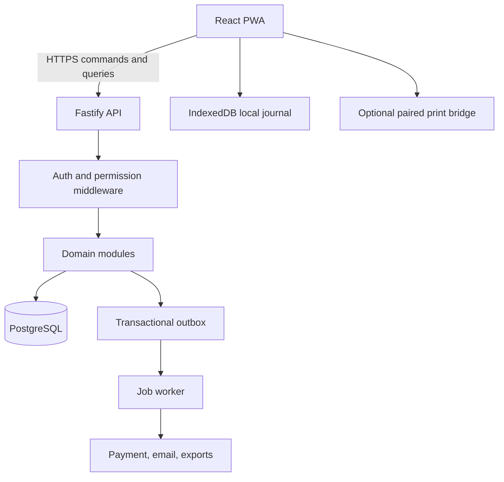

# Platform and solution architecture

## Architectural style
One TypeScript monorepo; a modular monolith API with domain modules; separate worker process using the same domain package and PostgreSQL; statically hosted React PWA; optional minimal print-bridge binary. PostgreSQL owns committed shared state. No direct browser database access. Begin on one VPS or cloud provider behind TLS reverse proxy with containers; move to managed Postgres/independent API instances when traffic justifies it.

## Logical data flow


## Vertical modular boundaries
`identity`, `tenancy`, `configuration`, `catalog`, `inventory`, `commerce`, `hospitality`, `procurement`, `accounting`, `staff`, `assets`, `reporting`, `integration`, `offline`, `audit`. Modules export domain commands/queries, not internal table access. Cross-module coordination only via orchestrated application transaction and post-commit domain events. Never publish an event that assumes a transaction succeeded before commit.

## Code topology
```text
mazao-erp/
  apps/pwa/              React UI, worker, IndexedDB
  apps/api/              HTTP adapter, auth, openapi, bootstrap
  apps/worker/           background tasks and integrations
  apps/print-bridge/     OPTIONAL standalone native service
  packages/contracts/   canonical versioned schemas and generated API types
  packages/domain/      invariant-focused domain/application services
  packages/db/          migrations, queries, unit of work
  packages/design/      accessible UI components/tokens
  packages/offline/     local ledger and reconciliation logic
  packages/testing/     fixtures, builders and contract harness
  infra/                containers, ingress, CI, backups
  docs/                 versioned specs and ADRs
```

## Transaction topology
Commands enter idempotency gate, validate actor+tenant+device, then domain service executes within a PostgreSQL transaction and records immutable audit/event and command result. Read models can be updated synchronously if necessary for immediate checkout correctness, or through an idempotent outbox consumer for eventual analytics. Use `SELECT ... FOR UPDATE`/concurrency versions on contested inventory/room/till records. External side effects (SMS, provider requests, actual print) are handled after commit via outbox and retries.

## Time and money
All persisted timestamps UTC with IANA timezone per tenant/outlet for rendering and business-day boundaries. Money stored as integer minor units (`BIGINT`) with ISO currency code, never binary floats. Quantity stored as decimal numeric/scaled integer with unit dimensions. Do not use JavaScript Date logic alone to define room-night or accounting-period boundaries; document local timezone business rules and DST tests even if initial deployment is Nairobi.

## Evolution
PWA and API version independently with explicit protocol compatibility. Add replicas, CDN and horizontal API later. Extract worker integrations or reporting only when observed load or independent scaling demands it. No dual-authority local SQLite vs PostgreSQL architecture for this greenfield system.
