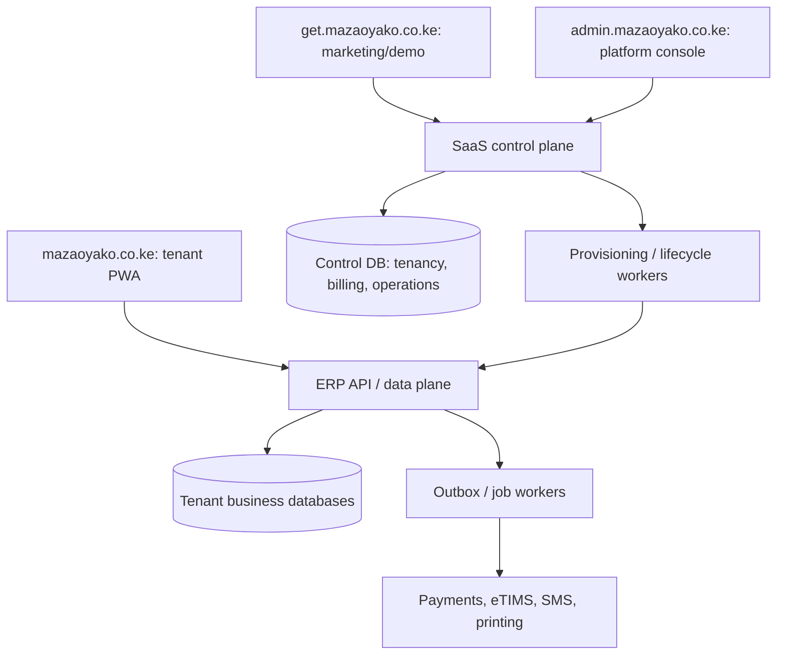

# MAZAO ERP — Full Functionality, Offline & SaaS Platform Master Plan

**Planning baseline:** 8 November 2026, Africa/Nairobi  
**Product:** Mazao ERP / Mazao Yako  
**Brand promise:** *Make your Business Smarter, Informed, Profitable.*  
**Repository:** https://github.com/davemusau00/mazao-erp-v1  
**Code baseline:** `main` at `0de9799aef2486547ed54b3d3a78b0475b11c231`  
**Status:** Implementation plan, not a statement that the planned features are currently built or live.

## Owner-approved execution update — 9 November 2026

This update records the selected delivery order and reconciles the plan against
the fetched `origin/main` at `0de9799aef2486547ed54b3d3a78b0475b11c231`.
It is a roadmap update, not implementation or release evidence.

The first delivery sequence is four separate, reviewed vertical-slice PRs:

1. Credential-operation recovery refinements.
2. Recovery navigation to the correct Manage, staff, assignment, configuration,
   or account workspace.
3. Product-import recovery/resume, preserving the original command ID and never
   silently re-uploading or reapplying source data.
4. Guest registration and check-in, after its API timeouts and arrival-browser
   failure are resolved.
5. Repair and merge restaurant/KDS PR #26 only after those prerequisites have
   passed exact-head CI and review.

Keep dirty worktrees intact and port only reviewed, unique changes onto current
main. Do not rewrite applied SQL or stored checksums. Current main already owns
`022_credential_operation_fencing.sql` and
`029_product_import_queue_archive.sql`; migration 029 is not available for a
new feature. Assign the next migration numbers from the actual main head, in PR
merge order, after checking each slice's schema needs. If an earlier slice needs
a migration, all later migration names must move forward together with their
registration, upgrade fixtures and documentation.

Backup automation remains deferred. Country/original Mazao at
`country.mazaoyako.co.ke` and Mazao Yako at `mazaoyako.co.ke` remain separate
tenants, databases, credentials, and release artifacts. Country uses the
standard PWA artifact with same-origin `/api/v1`; Yako uses its separate
API-targeted PWA. Refresh each live release/schema record before any rollout;
this roadmap work does not authorize production activation. The proposed
`get.mazaoyako.co.ke` marketing site and `admin.mazaoyako.co.ke` platform console
remain separate applications and require DNS/routing verification before use.

The following milestone table and execution notes are dated snapshots. The
latest state is recorded in the 22 November update below.

| Milestone | Current delivery state | Required evidence before advancing |
| --- | --- | --- |
| M0–M1 | In progress: credential recovery PR #28, recovery navigation PR #29, and import resume PR #30 are merged. Guest-registration PR #31 is open for exact-head hosted PostgreSQL/browser CI. Its clean branch passes local typecheck/build and focused Chromium arrival/recovery checks, while local PostgreSQL-backed acceptance was unavailable. Public Country/Yako endpoints respond, but runtime SHAs and schema heads remain unverified because SSH to the user-confirmed host is unavailable from this workstation. | Each prerequisite is a separate exact-head green PR; Country/Yako identities and schemas recorded without mixing their data. |
| M2 | Waiting on the prerequisite PRs; PR #26 is open and its lost-fire recovery browser gate remains unresolved. | Repaired exact-command recovery, migration upgrade/rerun, hosted CI, and review before merge; then the full two-station order-to-payment and physical-printer gates. |
| M3 | Not started as an accepted delivery milestone. | Hotel, location/recipe, procurement and statement corrections each reconcile source records, stock and accounting. |
| M4 | Eligible for an isolated ADR/spike after the M0 baseline; not a production control plane. | Two isolated tenants prove authenticated database routing, connection/job bounds, migrations, lifecycle and no cross-access. |
| M5 | Explicitly gated on stable online settlement and enrolled-device policy; no offline financial authority is accepted yet. | The approved 100-sale/restart/replay/conflict suite with pending receipt visibility and no duplicate sale or lost cash. |
| M6 | Not started. | Independent restore, security/privacy, accessibility/performance, fiscal-provider and controlled-release evidence signed before any GA claim. |

### Execution evidence update — 20 November 2026

At the latest local remote refresh, `origin/main` was
`b5fe1ba088d301a35cb9649bf17000266fa4c63c` (PR #30). PR #28 merged as
`416ea95`; PR #29 merged as `84de6f3`; PR #30 merged as `b5fe1ba` after its
exact-head hosted workflow succeeded. PR #30 has no API or migration delta.

Guest registration PR #31 is open at
`0631640fe5a221c80b84a5ea28af86d39f103f7c`, based on the merged main head,
with additive migration `030_guest_registration.sql`. Local
`npm run typecheck`, `npm run build`, and all five focused Chromium browser
cases passed. PostgreSQL-backed API and migration acceptance were skipped
locally because no disposable PostgreSQL service or `TEST_DATABASE_URL` was
available; exact-head hosted CI is pending. The earlier dirty guest worktree
remains preserved. These source checks do not establish production deployment
or live release state.

PR #26 remains open at `5138f118253eb5ac2e70fd1416ef9bc59189154c`; its
hosted TypeScript/build check is failed and its lost-fire recovery assertion is
not accepted. Do not merge it until the recovery semantics and required checks
pass after the four prerequisite slices. No production activation is claimed.

### Public deployment probe — 21 November 2026

Current main is `2a5da2d` (roadmap integration PR #32). Guest-registration PR
#31 now has exact head `901f84a`; local typecheck/build and the combined
guest-registration plus directory-history browser run pass. Its first hosted
run completed PostgreSQL/API acceptance but failed the full browser run because
the directory-history fixture did not stub the new registration-policy read.
That fixture now returns the reviewed policy, and the new exact-head hosted run
is pending. Do not merge until that run passes.

Read-only HTTPS probes returned `200` for the Country application at
`country.mazaoyako.co.ke`, its `/api/v1/health/ready` endpoint, the Yako
application at `mazaoyako.co.ke`, and Yako's
`api.mazaoyako.co.ke/api/v1/health/ready`. Both API bodies reported
`{"status":"ready","database":"available"}`. Country's page referenced
`/assets/index-iTu1ccv9.js`; Yako referenced `/assets/index-shlJi_f1.js`.
This confirms that both public routes respond and serve different asset
bundles. It does not identify a source SHA, migration head, tenant/database
identity, or which bundle is newer. Country resolved to `38.247.142.209`, also
the Yako API response IP; the Yako apex is proxied through Cloudflare. Keep the
products and data stores separate until runtime identities are verified.

The user confirmed `38.247.142.209` as the correct VPS IP. A direct read-only
SSH attempt to `administrator@38.247.142.209` was aborted before host-key
verification; an earlier `admin@38.247.142.209` attempt timed out. The legacy
`mazao-live` alias still points to `93.127.131.55`, so it is not a valid route
for the current deployment and must not be used for this baseline. No
known-hosts entry or SSH configuration was changed. Therefore the Country/Yako
release SHA and schema baselines remain open. Once SSH is reachable at the
confirmed IP with a verifiable host key, read the active static symlinks, API
image revision labels, and each database's applied migration ledger
independently. The proposed `get.` and `admin.` DNS and routes were not checked
by this probe.

### Delivery and deployment update — 22 November 2026

PR #31 (guest registration) merged as
`8df8d67bff6e1020e94a09f2e7d8bfde62d64cec`. PR #26 (restaurant configuration,
source orders/fire, and KDS ticket lifecycle) then merged as
`23cc0001d3d14607b2427e61126133bdaa30b359` from exact head
`01c3566b23ffdc24633e6c8c58826e7bd84afb1b`. Migration 030 remains guest
registration; migrations 031–033 are the restaurant slices. The existing 029
import-archive migration and earlier checksums were preserved. Exact-head hosted
run `45016674680` passed PostgreSQL migrations and checksum rerun, API tests,
typecheck/build, Chromium/Firefox desktop/mobile acceptance, real API/PostgreSQL
browser integration, Yako PWA/configuration validation, and production-container
readiness. Main-release artifact uploads were skipped for this PR. No live
deployment or production database migration occurred.

The owner reports that Country at `country.mazaoyako.co.ke` is behind the
deployment at `mazaoyako.co.ke`. This is an owner-reported version comparison;
the 21 November probes established different public bundles but could not
identify either source SHA or schema head. Continue to treat Country and Yako as
independent deployments, tenants, databases, and release artifacts. For Country,
first capture its active PWA/API release and applied migration head, compare
them with the intended release, and validate a rollback path. Do not copy Yako's
database or assume that replacing Country's bundle alone is a safe upgrade.

The correct VPS address is confirmed as `38.247.142.209`; the old `mazao-live`
SSH alias still points elsewhere. The existing SSH attempt did not complete
host-key verification, so production SHA/schema inspection remains open. Verify
the host key through a trusted channel before attempting authenticated release
inspection. Backup automation remains deferred. M2 is now in progress: the next
planned code slice is a durable restaurant KOT/BOT print queue; physical printer
acceptance is still outstanding.

## 0. Executive decision

Mazao should become a **managed, modular, multi-tenant business operating platform** for Kenyan retail, wholesale, bar/restaurant and hotel operators. The product must be commercially usable as an online ERP before promising offline settlement, and its SaaS administrative layer must be distinct from each tenant's business administration.

The implementation strategy is **evolutionary, not a rewrite**. Retain the React/Vite PWA, Fastify/TypeScript modular API, PostgreSQL financial and inventory authority, immutable command journal, migration runner, audited command execution and existing hosted CI. Harden shared contracts and extract necessary seams only when a vertical slice needs them. Existing code is source authority; older roadmap claims must be reconciled with the latest commit and tests.

**Five outcome gates:**

1. **G1 — Reliable online ERP:** existing core business jobs, security, reconciliation and recovery pass exact-commit staging and pilot acceptance.
2. **G2 — Complete online hospitality and retail ERP:** restaurant order→KOT/KDS→served→settlement→stock/accounting; guest booking→folio→checkout; stock procurement→sale→reports all work with corrections.
3. **G3 — Managed SaaS:** self-service/customer-assisted tenant provisioning, subscription/entitlements, platform-admin control plane, support, metering, usage and lifecycle management.
4. **G4 — Safe offline operations:** enrolled devices execute a specifically bounded policy offline and synchronize without duplicate or hidden transactions, with predictable conflict resolution and receipt status.
5. **G5 — Commercial/general availability:** tested security, eTIMS/payment integration path, independent backup/restore, physical hardware, performance, accessibility, privacy, support and operational runbooks.

Do not equate a rendered screen, green unit test, merged PR, produced artifact or responding health endpoint with a completed business workflow. Each is a separate evidence gate.

## 1. Verified baseline and immediate blockers

The baseline bullets below describe the 21 November review. Read the dated
execution updates below for later merges and acceptance results.

### What already exists in current main

- Sign-in, role-scoped sessions, staff management, outlet assignments and authenticated context changes.
- Business setup, tenant first-sale review and outlet creation/management.
- Catalog, goods/services item kinds, category lifecycle, reviewed CSV imports and failed import archive.
- Online cash/manual M-Pesa/customer-account sales, whole-line amount discounts, immutable receipts, cash refunds and shift close.
- Weighted-average inventory, reviewed receiving, stock counts, stock movement history, shortfall sales/provisional cost reconciliation.
- Customer AR balances/statements/repayments; suppliers, expense/full-delivery bills and partial recorded supplier payments.
- Balanced journal, partial operating reports, accounting periods and incoming manual M-Pesa matching.
- Core room/reservation/check-in/booked-night cash checkout and housekeeping state.
- Durable command idempotency, status recovery and a strong hosted CI suite.

### Not in main or not yet complete

- Restaurant/KDS implementation is on open PR #26, not main; its lost-fire-acknowledgement browser gate and migration numbering need reconciliation with main's already-applied 029 import-archive migration.
- Restaurant print/served/void/settlement and guest-room charge remain unfinished even on PR #26.
- First-class locations/transfers, recipes/sealed-open, packages, purchase orders, partial invoice matching, split tenders, broader refunds, folios, complete finance statements, full hardware integration and real offline financial operations remain incomplete.
- No independent SaaS billing/provisioning/support control plane or platform-admin console exists in this repository.
- Live production SHA/schema for each deployment, off-host restoration and physical printer/terminal acceptance are not verified by this planning exercise.
- Four old open PRs (#13–#16) are patch-equivalent to main and should be closed as superseded after evidence review. Main reports unprotected and no rulesets.

## 2. Product scope, editions and actors

### Product modules

**Universal foundation:** Today dashboard, sales, customer accounts, items, inventory, purchasing, staff, shifts/cash-up, finance, reports, settings, audit, help and integration hub.

**Retail/wholesale:** fast scan sales, price lists, customer tiers, wholesale pack conversions, stock locations, transfers, stocktake, sales orders/quotes, purchasing, returns, supplier/customer ledgers, gross-margin and reorder intelligence.

**Bar/restaurant:** tables, waiters, tabs, modifiers, KOT/BOT, kitchen/bar stations, KDS, preparation/serving statuses, void approvals, split/transfer bills, recipe/yield/volume consumption, cash/M-Pesa/credit settlement.

**Hotel:** room types/rates/availability, reservations, stays, deposits, guest folios, service and restaurant charges, room changes/extensions, payments/refunds, housekeeping/maintenance and occupancy/ADR reports.

**Services and mixed businesses:** nonstock service items, job charges, customer balances, receipts and reporting without fictitious stock deductions.

### User classes and permission boundaries

| User class | Authority | Never implied |
| --- | --- | --- |
| Platform Superadmin | Control-plane settings, plans, emergency policies | Routine access to tenant financial data or passwords |
| Platform Operations | Provisioning, migrations, backup/health views, incident response | Tenant sale modification |
| Platform Billing | Subscription invoices, collections, credits and dunning | Tenant business ledger edits |
| Platform Support | Case-linked diagnostics and permitted scoped support sessions | Permanent impersonation or unrestricted data export |
| Platform Security/Auditor | Privileged-access and audit reports, policy review | Business command execution without explicit permission |
| Tenant Owner | Business, billing ownership, outlets, managers, plans/usage | Platform-wide access |
| Tenant Admin/Manager | Authorized staff, inventory, restaurant, hotel and approvals | Access to other tenants |
| Cashier/Waiter/Cook/Store/Housekeeping/Finance | Job-specific task screens with least privilege | Implicit administrator rights |

Offer capability-based product profiles: **Starter Retail**, **Business/Wholesale**, **Hospitality**, and **Enterprise/Custom**. Product entitlements are versioned server-side policy, not just hidden menus. Do not commit prices before market and cost validation; define price books in KES with monthly/annual periods, trial length, staff/devices/outlets, storage/transaction limits and optional add-ons.

## 3. Target architecture and migration strategy

**Keep control-plane and data-plane authorization separate.** A tenant admin is not a platform admin. A platform operator must not silently act as a cashier. All business money, orders, accounting and inventory remain in tenant databases with auditable commands.

### Recommended first SaaS isolation model

Adopt a **separate control-plane PostgreSQL database plus database-per-tenant in a shared PostgreSQL cluster for initial managed SaaS**. This fits the existing guarded empty-business bootstrap and avoids rewriting the financial invariants for a pooled shared-tenant database at launch. Use distinct tenant database roles/credentials, logical backup/restore identities, migration checkpoints and per-tenant quotas.

This is an architectural decision to capture as an ADR and prove with a two-tenant spike. It is not free: the API currently assumes a global `pool`, so an authorized request-to-tenant database resolver, bounded per-tenant connection pools, migration orchestration, background-job tenant context and connection-pressure tests are mandatory. Existing separate deployment stacks can be registered as legacy managed targets during transition. Do not cut over a working tenant just to satisfy the new control-plane design.

At 100+ tenants, benchmark pooled-database cost, migration time, connection count and backup restore. A possible later pooled shared-schema tier requires verified RLS/composite-FK isolation and explicit migration planning; **do not mix isolation models per-request without an ADR and testable resolver**.

### Component boundaries

1. **Tenant PWA:** existing React UI; role/capability navigation; offline local journal; responsive touch/keyboard; local print service boundary.
2. **ERP API:** auth/session, canonical versioned commands, idempotency, RBAC/ABAC, domain transaction, tenant DB, queries/read models, audit/outbox.
3. **SaaS API/control plane:** platform identity, organization/customer identity, tenant registry, plans, subscriptions, entitlements, provisioning jobs, metering, invoices, support, health and audit. No direct tenant financial writes.
4. **Workers:** outbox delivery, sync feed compaction, print adapter coordination, subscription billing, notification, tax/provider delivery, provisioning and backup verification.
5. **Storage:** tenant DBs, control DB, encrypted object storage for exports/media, audit logs, device journals (local IndexedDB).
6. **Infrastructure:** containerized stateless API/worker, ingress TLS, database backups/PITR where supported, immutable build artifacts, environment secrets, monitoring and incident response.

### Cross-cutting invariants

- Every business mutation has explicit tenant/outlet/user/device context, canonical schema, permission and plan capability, expected version, atomic effects, audit record and idempotent result.
- In managed SaaS, the ERP API resolves a tenant database from the authenticated control-plane registry. A caller-supplied tenant ID is never database-routing authority. Platform billing and support records remain in the separate control database, outside tenant ledgers.
- Entitlements and lifecycle state are versioned and enforced by the server. Suspension can restrict new mutations while retaining posted records and controlled read/export access; it never erases or silently changes tenant books.
- Monetary values are exact integer minor units; quantities are decimal-safe; immutable posted documents receive reversals/corrections, never invisible mutation.
- No payment or KOT is called complete on a missing acknowledgement. External effects execute after database commit through an outbox and retryable worker.
- Tenant billing never enters a tenant's shop ledger by accident. Plan suspension cannot delete, alter or conceal recorded sales/financial history.
- A local offline receipt is not a confirmed synchronized fiscal or provider transaction.
- User-facing availability is governed by implemented runtime capability + subscription + role, not prototype presence.

## 4. Business ERP completion workstreams

### A. Core POS and sales

**Deliver:** scan/search/cart, item/qty/discount, hold/resume tabs, quotations, variable pricing within allowed policy, customer account selection, cashier-confirmed manual M-Pesa, online provider verification when configured, mixed/split tender, invoice/receipt, corrected returns, cash-ups and sales audit.

**Critical vertical flows:**

1. Cash sale → stock consumption → taxes → ledger → receipt → shift close → report.
2. Manual M-Pesa sale → explicit evidence confirmation → tender posting → statement matching → correction with linked evidence.
3. Customer-account charge → AR posting → partial/mixed collection → statement → linked correction.
4. Mixed tender → one order with exact allocations and per-tender reversal policies; replay one command only.
5. Return/exchange → original order line and tender proof → restock/rejection → COGS and tax correction → linked customer refund.

**Acceptance:** serializable concurrent checkout, zero double charges under retries, void approval limits, source-accurate accounting, full reconciliation to shifts and exports, scanner/80mm physical device tests, mobile and 1024×600 UX.

### B. Inventory and catalog

**Deliver:** product variants, barcode aliases, units, conversion packages, price lists, warehouses/stock locations/bins, receiving, location transfers, damage/waste, manual adjustments with approvals, stock reservations/provisional quantities, movement ledgers, valuation and cost reports, counts by location/selection/blind review and expiry/batch if the vertical requires it.

**Special hospitality semantics:** bottle as stocked base volume or controlled sealed/open stock identity; serving a measured shot consumes normalized ml from the proper batch/location; prepared menu item consumes its recipe ingredients/yield, never decrements a fictitious finished SKU by itself. Recipes have reviewed revisions and sale-time snapshot/cost policies.

**Acceptance:** conversion round trips, transfer atomicity, no negative/duplicated valuation, no simultaneous count+transfer silent overwrite, repairable count conflicts, historical inventory reconciliation, multi-outlet isolation, exact COGS.

### C. Procurement and suppliers

**Deliver:** supplier directory, requisition/PO, authorized approval, partial/over/short receipt, purchase invoice matching, landed costs and taxes, supplier return/credit note, payment allocation, account statement, duplicate invoice protection and purchasing reports. Move current full-delivery-bill foundation into real multi-step receipt/invoice links with source evidence.

### D. Restaurant/bar/KDS

**Integrate PR #26 only after red CI and migration conflict are fixed.** Then complete:

1. Menu/station/table assignment → saved waiter order → immutable fire batch.
2. Station-specific KOT/BOT (NEW/ADD_ON/VOID/COPY labels) → durable printer job → operator-visible delivery/failure evidence.
3. KDS NEW→ACKNOWLEDGED→PREPARING→READY→SERVED with actor/device, timestamps, station scope, stale/conflict guards, hold/availability/void.
4. Table move, item move, tab split/merge with immutable prior evidence and exact quantities.
5. Original source order settlement: cash, manual/provider-confirmed M-Pesa, account or approved mixed tender; correct recipe consumption/COGS, sales tax, journal and receipts.
6. Room charge to a verified checked-in guest folio through its own authorization; no arbitrary room ID posting.

**Acceptance:** two waiters and two stations, network loss after fire, printer outage, add-on ordering, wrong/outdated device, a stale quote, canceled item, service completion, paid/part-paid source order, shift close and no duplicate food/stock/payment effects.

### E. Hotel and hospitality

**Deliver:** room types, season/day rate plans, availability calendar, holds and expiry, quote → reservation → check-in, deposits and liabilities, guest identity/consent, checked-in folio, incidental and restaurant charges, stay extension/room move, partial payments/refunds, early/late checkout rules, housekeeping/inspection/maintenance hold, occupancy and ADR/RevPAR and guest balance reports.

**Acceptance:** competing room bookings, date/timezone rules, deposit/advance aging, guest folio totals, no duplicate room charge, room move history, actual-vs-booked-night billing, checkout with outstanding balance policy and correct dirty/ready transition.

### F. Accounting, reporting and intelligence

**Deliver:** complete source reconciliations; configurable-but-controlled chart/posting map; opening balances; tax accounts; bank and M-Pesa clearing; supplier/customer ledgers; fixed assets, depreciation and accruals where in edition scope; corrections; period close; trial balance; P&L, balance sheet and cash flow; audit/exceptions; scheduled reports and CSV/PDF exports.

**Role reports:** owner KPI and margin; cashier tender/shift variance; store movement/count/valuation; buyer PO/payables/reorders; waiter order/service productivity; hotel occupancy/ADR/RevPAR/folios; platform usage/billing (never mixed with tenant finances).

**Acceptance:** report provenance, immutable source linkage, correct business-day timezone, cross-outlet scope, balanced journal controls, no double-counted customer collections, scale/pagination and reconciliation to source transactions.

## 5. Offline protocol: limited but genuinely operational

### Offline release policy table

| Operation | Initial offline policy | Authority / failure behavior |
| --- | --- | --- |
| View assigned catalog/prices/stock snapshot | Allow cached, clearly stale | Versioned tenant/outlet projection and age label |
| Create local cash sale | Allow **only with a valid online-issued signed grant** for one enrolled cashier terminal, cashier, outlet and shift | Enforce per-sale and per-shift cash caps; commit a uniquely identified receipt durably before success and mark it pending sync |
| Reprint local pending receipt | Allow | Same original local receipt number, always label copy/status |
| Draft restaurant order | Allow drafts | No KOT fire until server accepts or explicit reserved-resource offline contract exists |
| Capture count observations | Allow offline draft/evidence | Never post stock adjustment until server reviews current stock |
| M-Pesa/provider confirmation, refunds | Online only | May note an M-Pesa reference as unverified; never mark it paid offline |
| Hotel booking/checkout, supplier payments, period close, role changes | Online only | Recheck current server state and authorization |
| Cashier shift opening/closing | Grant-scoped local evidence, final close online | Enforce shift/device ceiling; reconcile local cash before canonical close |

### Device enrollment and offline grants

Enroll a physical terminal while online; associate device key/public identity with tenant, outlet and authorized user; revoke remotely. An owner or delegated manager issues each signed, short-lived grant online for exactly one enrolled cashier terminal, cashier, outlet and shift. Include allowed command types, per-sale and per-shift cash limits, catalog/price version, device sequence bounds and expiry. Cache the versioned catalog and prices; every sale retains the exact price and tax snapshot shown to the cashier. Do not permit offline stock adjustments or negative stock balances.

If replay finds that current stock cannot cover a locally committed cash sale, post that exact cash sale once and create immutable shortfall and provisional-cost evidence through the existing reconciliation path. Keep the exception visible for manager resolution; never discard the collected-cash evidence or manufacture an offline stock correction.

### Local durable data model

IndexedDB stores: schema/version, device metadata, authorized projections/cursors and hashes, immutable command envelope, local command result, journal status, shift/cash evidence, print queue, export/recovery metadata, and bounded draft source records. Do not store reusable passwords, unrestricted tokens or secrets in a general Cache API. Ask for persistent storage where supported, continuously show quota/backup warnings and provide encrypted incident recovery export. Browser data can be evicted: design support/recovery around that risk.

### Offline command state machine

`DRAFT → LOCAL_PREPARED → LOCAL_COMMITTED → PENDING_SYNC → SERVER_CONFIRMED | RECONCILIATION_REQUIRED | REJECTED`

The cashier sees **Local cash sale saved; awaiting synchronization**, not ordinary online success. The local receipt preserves the original command UUID and device sequence. Only a durable local transaction can advance to LOCAL_COMMITTED. A crash after printing but before acknowledgement must be recoverable without selling a second time.

### Synchronization engine

- Push ordered immutable journal records, exact original IDs and hashes; never invent a new command on timeout.
- Server returns stored original results for replay and fences conflicting/expired/over-limit grants.
- Pull tenant/outlet-scoped authoritative changes using signed/opaque cursors; apply projections idempotently, then persist cursor atomically.
- Reconcile local stock allocations/exposure and cash evidence, not just order counts.
- Support partial batches, outage/restarts, backoff, manual retry and an operator-visible **Sync Center**.
- Background Sync is an opportunistic optimization, not the sole delivery mechanism; open PWA, focus, connectivity and manual triggers must be reliable fallbacks.
- Automatically resume synchronization on reconnection and expose foreground/manual retry in the Sync Center. Keep every receipt pending until the server confirms that original command ID.
- Stop unsafe new offline commits after grant expiry, device switch, corrupt local journal, quota exhaustion or incompatible schema; preserve prior evidence read-only.

### Offline release test suite

100 cash sales, intermittent restarts, five replay passes, lost response after server commit, expired/revoked grant, competing devices, late price/stock changes, two tabs, browser upgrade/IndexedDB migration, full quota, clock skew, local journal export/recovery, pending printer jobs, stale customer balance, customer refund attempted offline, offline then tenant suspension, wrong-device restoration. **Invariant: no duplicate posted sale/payment/COGS; no silently lost collected cash.**

## 6. SaaS control plane and platform-admin interface

### URL and application boundaries (proposed)

- `get.mazaoyako.co.ke` — marketing, demos and signup CTA (existing separate work).
- `mazaoyako.co.ke` — tenant-facing ERP; optional customer subdomains/domains after validation.
- `api.mazaoyako.co.ke` — tenant data-plane API and auth/origin policies.
- `admin.mazaoyako.co.ke` — **staff-only platform administrator console**, protected by its own identity and MFA.
- Optional `status.mazaoyako.co.ke` — service incident/status communications.

### Platform admin sitemap and workspaces

| Workspace | Screens / jobs | Required safeguards |
| --- | --- | --- |
| Overview / command center | Active/trial/past-due tenants, uptime, transaction volumes, failed provisioning, incidents, backup freshness, license revenue | Aggregated tenant-safe metadata only |
| Tenants | Search, lifecycle, owner contact, plan, created date, region, database target, activation, trial, suspended state, last sync | Scoped edits; no undeclared direct tenant data access |
| Tenant detail | Tabs: Summary, Outlets/Devices, Entitlements, Billing, Activity, Health, Backups, Support, Audit | Show business data only through approved tenant support workflow |
| Provisioning | Create tenant, allocate DB, migrate, seed owner, prepare URL/config, verify readiness, activate; retry/rollback | Job state machine/idempotency and no duplicate business |
| Plans & entitlements | Packages, trial, feature flags, hard/soft limits, add-ons, overrides, effective date | Versioned entitlements and explicit commercial approvals |
| Subscriptions & billing | Invoice runs, tax, receipts, trial/grace, payment matching, credit adjustments, dunning, refunds, cancellations | Separate SaaS billing ledger and payment idempotency |
| Usage & metering | Active devices, outlets, staff, storage, orders/API calls, offline exposure, overages | Event version, monotonic counters and corrections |
| Deployments & migrations | Release fleet, desired vs active SHA/schema, canary, migrate/rollback status, incompatibility alerts | Approval, immutable release and staged rollout |
| Devices & offline | Enrolled terminals, offline grants, expiry, pending sync, revocation, failure reasons | No changing actual past commands; emergency fence |
| Health, alerts & backups | API/DB/queue health, backup age, restoration drills, incidents, worker backlog | Pager/incident acknowledgments, no plaintext secrets |
| Support desk | Ticket/case, user history, authorized diagnostics, one-time scoped assist, resolution | Tenant approval, time bound, watermarked access, full audit |
| Security & audit | Platform actors, MFA, policy, privileged operations, login, data requests and access logs | Immutable event evidence; separate security role |
| Integrations | Tax and payment provider connections/status, webhooks, SMS/email, feature rollout | Secret manager, webhook verification, scoped rotation |
| Commercial analytics | MRR/ARR, churn, activation, cohort, feature adoption, support SLA, retention | Do not conflate SaaS revenue with tenant sales |

### Tenant lifecycle state machine

`LEAD → TRIAL_REQUESTED → PROVISIONING → SETUP → TRIAL_ACTIVE/ACTIVE → GRACE → READ_ONLY/SUSPENDED → CANCELED → RETENTION → DELETED`

Transitions require an explicit actor/reason and idempotency key. A failed provisioning job is retryable or compensatable without deleting unrelated resources. Trial expiry and payment delinquency **never erase posted tenant records**. Prefer controlled read-only and export access according to contract and retention policy; do not allow silent financial writes after suspension.

### Control-plane data model (minimum)

`platform_users`, `platform_roles`, `platform_sessions`, `organizations`, `tenant_registry`, `tenant_owners`, `tenant_database_targets`, `provisioning_jobs`, `provisioning_steps`, `plans`, `plan_versions`, `subscriptions`, `entitlements`, `entitlement_overrides`, `usage_events`, `usage_aggregates`, `billing_invoices`, `billing_invoice_lines`, `billing_payments`, `billing_adjustments`, `payment_webhook_events`, `support_cases`, `support_access_grants`, `release_targets`, `tenant_migration_runs`, `backup_checkpoints`, `device_summary`, `platform_audit`, `incidents`, `integration_connections`.

Keys: tenant stable public ID, globally unique event ID and command ID, provider request reference, version and effective-at. Subscription invoice records are immutable with corrective credit documents, not rewritten after payment. Control-plane data has no SQL foreign keys across tenant DBs; cross-system references are stable external IDs and verified through orchestration.

### SaaS billing model

Support monthly/annual subscriptions, trials, one-time onboarding fees, optional add-ons, outlet/device/staff quotas and taxes. Start with manual invoicing plus controlled payment confirmation if needed; add automated provider callbacks only after their signature/transaction-id and reconciliation contracts are tested. Dunning sequence: upcoming renewal → invoice → reminder → grace → restricted mutations → support resolution/cancellation. Include proration rules, upgrades/downgrades, credit notes and refund policies, avoiding mid-period silent feature removal.

### Platform access hardening

MFA for platform staff; separate auth origin and secret issuer; least privilege; no password viewing; short-lived support grants with tenant approval; audited break-glass emergency flow requiring reason/expiry and independent review; immutable privileged activity, PII minimization and standard data access/export/erasure workflows with statutory retention exceptions.

## 7. Provisioning and tenant onboarding

1. Customer requests trial or sales team creates qualified lead.
2. Platform validates account identity, email, plan and idempotency key.
3. Provisioning worker allocates tenant database/schema role and secrets, runs all approved migrations, performs health/checksum validation and registers tenant endpoint.
4. Deliver a one-time invitation to set owner credentials; no password in provisioning logs.
5. Owner completes wizard: legal profile → business capabilities → outlets/time zones/tax → staff/devices → items/CSV/import review → printer and payment settings → sample non-posting rehearsal → signed go-live review.
6. Mark tenant LIVE only after transactional validation and owner approval; publish platform status and audit events.
7. Test first sale and first close with a supervised acceptance script; keep support evidence.

Provisioning must support no duplicates on double-click, retry after worker crash, database secret rotation, failed migration quarantine, manual approval for high-risk restores, backup/restore and tenant cancellation with retention. No synthetic paid orders in production business books.

## 8. Integrations, Kenya compliance and commercial controls

**KRA eTIMS:** design a fiscal invoicing adapter and certification track for OSCU/VSCU or approved integrator as appropriate; distinguish Mazao receipt, submitted eTIMS invoice and accepted fiscal acknowledgement. KRA describes system-to-system integration and a developer testing/vetting/certification path, so do not market Mazao as certified merely because a request can be generated. The online/offline tax invoice path must be independently accepted. Source: https://www.kra.go.ke/business/etims-electronic-tax-invoice-management-system/learn-about-etims/etims-system-to-system-integration

**Kenyan data protection:** treat Mazao-as-host/provider and business tenant as distinct controller/processor relationships requiring review. Create customer contracts, privacy notice, subprocessors, consent/lawful-basis map, access requests, retention, incident/breach workflow, encryption and audit. Verify ODPC registration and obligations with qualified counsel. Sources: https://www.odpc.go.ke/data-protection-laws-kenya/index.html and https://www.odpc.go.ke/data-protection-compliance/

**M-Pesa:** keep manual cashier confirmation as a bounded workflow; later integrate Daraja C2B/STK/transaction status callbacks through a provider adapter with credentials vault, signature/source validation where supported, duplicate callback protection, asynchronous status and reconciliation. Delayed callbacks never create a second paid sale. Source: https://developer.safaricom.co.ke/

**SMS/email/WhatsApp:** invitations, receipts, alerts and operational notices through approved templates, opt-in records, delivery state and queues; no financial success inferred from provider delivery. Keep transactional messages separate from marketing consent.

**Hardware:** browser print fallback plus optional paired print bridge for ESC/POS 58/80mm, scanner keyboard wedge, USB/network profiles, copy/reprint audit, kitchen/receipt templates, cash drawer triggers, offline job spool and safe recovery. Avoid a browser-specific print promise until the target terminals are physically tested.

**Public API/webhooks:** tenant-scoped API credentials and idempotency, audit, rate limits, versioned schemas, event delivery retries, webhook verification and sandbox; start only for high-value integrations after internal invariants are stable.

## 9. Security, operations, infrastructure and scalability

### Required baseline

- Protected `main`, required exact-HEAD CI, mandatory reviewers for finance/stock/offline/security, code ownership and release signatures/hashes.
- MFA for platform, configurable tenant MFA for privileged users, secure sessions/CSRF/CORS, safe rate limits and password/recovery policy.
- Tenant boundary tests for every API and background worker; no `tenantId` authority from arbitrary browser input.
- Secrets manager/key rotation, encryption in transit and at rest, least-privilege DB roles, isolated backups, no credentials in log/URL/build artifacts.
- Immutable event/audit journal with correlation IDs, no raw payment/guest PII in general logs; retention and subject-access workflow.
- Automated vulnerability/dependency checks and risk-based security review, especially file imports, auth, tenancy, billing and offline replay.
- Rate, size and CPU limits for import/report APIs; paginated exports and asynchronous heavy reports.

### Reliability targets (proposals, must be measured)

- Stage A: 1 tenant / 1–5 devices / ~1,000 items; Stage B: 100 tenants with multiple outlets and devices.
- Standard online API command p95 target ≤ 300 ms excluding network/external provider; warm PWA POS ready ≤ 2 s and cashier add-to-basket feedback ≤ 100 ms on accepted 8 GB/Celeron hardware.
- Target 99.9% monthly availability after GA. Aim for RPO ≤ 15 minutes and RTO ≤ 4 hours **only after independent restore drills**; posted financial data must meet no-unexplained-loss invariants.
- Load and capacity tests for simultaneous checkout, KDS fire/serve, stock count, tenant activation, plan changes and sync bursts.
- Accessibility target WCAG 2.2 AA, with automated and manual keyboard/voice/touch checks.

### Release environments

`dev` → ephemeral PR integration → isolated staging with disposable tenant DBs → canary pilot(s) → controlled production cohorts. Keep Country/original Mazao, Mazao Yako and other established deployments intact during transition. Track source SHA/API image digest/PWA hash/schema version per tenant. Run database migrations additive/forward only; preserve rollback of application while older DB schema remains compatible. No destructive migration without a rehearsal, fresh backup and explicit approval.

### Observability and support

Metrics: API p50/p95/p99, DB pool/connect latency, deadlock/retries, queue lag, failed outbox jobs, sync pending/age/conflict, fiscal submission pending, print queue age, payment callback anomalies, tenant provisioning and migration health, backup freshness, business-transaction invariant alarms. Platform admin sees tenant-safe operational health; support links to exact command/receipt/ticket references.

## 10. Delivery roadmap — dependent milestones

The sequence below is a planning hypothesis for a focused small engineering team; times are **elapsed ranges with coordinated design/QA and some parallelism**, not fixed promises. Work with one developer or without dedicated testing will extend the schedule.

| Phase | Approx. elapsed | Primary deliverable | Exit gate |
| --- | --- | --- | --- |
| **M0: Baseline/release truth** | 1–2 weeks | Refresh Country/Yako release and schema evidence, reconcile worktrees/migrations and superseded PR inventory, record isolation/offline ADRs; preserve user-owned changes. Branch-protection changes and production activation are separate decisions. | Exact-main hosted CI and known per-deployment revisions/schema; no cross-contamination of Country/Yako data |
| **M1: Core online reliability** | 2–4 weeks | Four separate PRs in order: credential recovery, recovery navigation, product-import resume, guest registration; resolve guest API timeouts and arrival-browser failure | Each exact-head PR passes recovery, role/tenant, migration, browser and business-effect gates before advancing; KDS pending recovery retains the original command until confirmation is durably recorded |
| **M2: Restaurant/KDS to settlement** | 4–8 weeks | Repair and merge #26 after M1, then separate printer queue, served/void, settlement/split tender, and recipe/location slices | Two-station complete paid order/stock/accounting/receipt reconciliation plus physical printer pass |
| **M3: Hotel + inventory/procurement** | 5–9 weeks | Folios/deposits/checkout; locations/packages/recipes; PO/partial receipt and credits | Hospitality shift and procurement/valuation close reconciled |
| **M4: SaaS control plane** | 4–8 weeks | In parallel with M2 after the M0 baseline, isolate admin identity/control DB, resolve tenant DB from authenticated registry, and prove bounded pools/jobs/migrations against two tenants before provisioning, versioned entitlements, manual invoices/payment matching, support and lifecycle | Two isolated tenants provisioned/changed/suspended/restored with audit and no cross-access; posted books remain readable/exportable under suspension |
| **M5: Offline v1** | 5–9 weeks | Only after online settlement and device policy stabilize: one-terminal/cashier/outlet/shift grants, bounded cash, price/tax snapshots, durable pending receipts, Sync Center and manager stock-shortfall reconciliation | 100-sale/outage/restart/replay/device-conflict suite and physical offline cashier acceptance |
| **M6: GA operations & compliance** | 3–6 weeks | eTIMS integration path, provider/hardware tests, DR, privacy, support, docs, load/accessibility | Release gate G5 signed with independent restore and business UAT |

Dependencies matter more than calendar. M4 control-plane foundations can begin while restaurant is being completed; M5 offline **business financial authority** should not be declared ready before settlement, stock and device policy are stable. Some inventory and hotel work can run in parallel only if their shared money/stock interfaces are frozen and tested.

### Sprint-size epics and sequencing

| Epic ID | Product/engineering increment | Dependencies | Proof of done |
| --- | --- | --- | --- |
| P00 | Repository governance, release inventory and CI contract | None | Protected main, exact-head runs, deployment baseline |
| P01 | Contract/runtime error and recovery hardening | P00 | No unknown command presents false success |
| P02 | Restaurant PR migration/CI reconciliation | P00–P01 | All hosted lanes pass, no migration collision |
| P03 | Printer profiles and durable KOT/BOT delivery | P02 | Lost/repeated/outage print cases on physical device |
| P04 | KDS served/void/hold and waiter handoff | P02–P03 | Correct actor/role and no stale transitions |
| P05 | Restaurant source-order settlement and split tender | P02–P04 | One payment/stock/journal per exact original order |
| P06 | Package/volume/recipe consumption and stock location ledger | P02/P05 interfaces | Conversions and COGS accounting accepted |
| P07 | Hotel folios, deposits, service charges and checkout | P05 order posting | Guest balance and room close accepted |
| P08 | Procurement PO/partial invoices, credits and cost | P06 | Receipt/AP/inventory reconciliation |
| P09 | Full sale returns/approvals/customer allocations | P05–P08 | Reversals tied to original evidence |
| P10 | Full finance source and reporting statements | P05–P09 | Trial balance and statements reconcile |
| S01 | SaaS data isolation ADR/resolver and platform identity | P00 | Two-tenant isolation, platform MFA |
| S02 | Provisioning orchestration and tenant setup | S01 | Retry-safe new tenant and owner wizard |
| S03 | Entitlements/plans/usage metering | S01–S02 | Server-enforced quotas and policy changes |
| S04 | Subscription invoicing/payment/dunning | S02–S03 | No duplicate charges, correct grace behavior |
| S05 | Platform admin dashboard/support/operations | S01–S04 | Scoped audit, support grant and incident flows |
| S06 | Tenant migration, restore, suspension/deletion controls | S02/S05 | Restore/isolation/retention drills |
| O01 | Device enrollment/offline grant verifier | P01/S01 | Revocation, expiry and sign/verify adversarial suite |
| O02 | IndexedDB journal/projections/local cash ledger | O01/P05 | Durable local sale without double payment |
| O03 | Server sync feed, replay and reconciliation worker | O02 | Cross-device restart/conflict suite |
| O04 | Offline receipt/print/recovery UX | O02–O03/P03 | Physical terminal 100-sale acceptance |
| Q01 | Payment/eTIMS/notifications adapter acceptance | Relevant source domains | Provider sandbox/contract/idempotency tests |
| Q02 | Capacity, accessibility, DR, security, docs and GA | All release-critical | Signed acceptance evidence pack |

Each epic should produce multiple small vertical-slice PRs, not one giant merge. Every PR includes a feature flag, migration or schema evidence when applicable, contract, API/domain, UI, negative tests, docs, measured impact and release-rollback story.

## 11. Release criteria and test matrix

### Must-pass classes for every financial/stock PR

1. Typecheck, build, lint/static checks, dependency and import validation.
2. Fresh PostgreSQL migrations, applied-schema upgrade/backfill and checksum-safe rerun, including prior published versions.
3. Tenant/outlet isolation, role/capability/plan authority, malformed input, race/version conflict and idempotent replay.
4. Business-effect accounting: money, quantities, taxes, stock movement, AR/AP, journal balance, immutable historical snapshots.
5. Recovery after lost response or backend crash; never duplicate command or lose unknown evidence.
6. Chromium/Firefox, desktop/1024x600/mobile, keyboard/touch and selected screen-reader journeys.
7. Production API image and PWA artifacts built on the same exact passing SHA with independent staging activation.
8. Operational runbook, backup/restore impact, support/training change and audit metadata.

For the selected M1 slices, guest acceptance must resolve the recorded API
timeouts and arrival-browser failure. KDS lost-fire acceptance must retain the
original command ID while outcome is unknown, and remove its journal entry only
after the matching confirmed result has been durably recorded. Neither health
checks nor a previously green SHA satisfy these changed-head gates.

### End-to-end acceptance journeys before GA

- **Retail day:** onboard → import → receive → count → scan/cash/M-Pesa → return → close shift → journal/report.
- **Restaurant shift:** menu/stations → waiter save/fire/add-on → print → cook ready → served → split/pay → stock recipe → shift close.
- **Hotel stay:** quote/reserve → deposit → check-in → restaurant folio → partial charge/pay → room move → checkout → housekeeping → ledger.
- **Wholesale cycle:** price/package → PO → partial receipt → landed cost → supplier bill/pay → stock transfer → bulk customer sale/credit → statement.
- **Offline outage:** enroll → obtain bounded grant → lose network → 100 cash sales → reprint → reconnect → replay/reconcile → verify no duplicate/hidden cash.
- **SaaS lifecycle:** sign up → provision → invite owner → configure → first sale → upgrade plan → usage overage → payment grace → suspension/read-only → restore → export/cancel.
- **Security:** cross-tenant object attack, role escalation, stolen/revoked device, failed billing webhook replay, host/origin spoof, privileged support access, secret rotation.
- **Disaster recovery:** corrupted worker, stopped API, failed migration, lost DB replica, off-host restore to independent target, artifact rollback with forward-compatible database.

## 12. Documentation, onboarding and support deliverables

- **Learner quick reference:** cashier sales, count, receiving, returns, shift close, restaurant KOT/KDS, hotel front desk and common error blockers.
- **Role workbooks:** screenshots/visual flow guides, scenarios, exercises, sign-off checklist and training records for owner/manager/cashier/store/waiter/kitchen/front-desk/accounts.
- **Operator guides:** online/offline status meanings, sync pending/retry/conflict, duplicate receipt, printer failure, M-Pesa not verified, accounting close, permissions.
- **Tenant admin manual:** outlets, staff, devices, entitlements, plan usage, exports, backup/restore requests, support authorization.
- **Platform admin handbook:** provisioning, billing, troubleshooting, feature flags, migration, security incidents, restore and support access.
- **Developer docs:** canonical contracts, schema/migration strategy, environment secrets, tests, offline protocol, event and webhook semantics, ADRs and release runbooks.
- **Commercial pack:** offer tiers, terms/SLA, data processing terms, privacy, pricing assumptions, procurement/security FAQ, demo tenant, onboarding checklist and support escalation.

Help must describe *real* configured behavior, not planned features as if already live. Build feature-aware content from the same availability registry that protects the UI and API.

## 13. Resourcing, estimates and commercial rollout

### Staffing model

Minimum sustained engineering capacity: one backend/domain owner, one frontend/PWA owner, one QA/automation/integration owner (part time only if scope is cut) plus design/DevOps/security support. Shared finance/domain review is essential for accounting/offline. With one full-time engineer, the plan remains possible but the calendar expands dramatically; parallel workstreams are constrained by the same database and contract boundaries.

**Indicative schedule:** about **six to ten months** for a cohesive small-team implementation and staged acceptance, subject to scope decisions, provider approvals, physical devices, production access, defects and paid integration certification. One developer working alone should treat this as a substantially longer program, not a sprint-month promise. Establish rolling two-week forecasts after the first 2–3 sprints and measured velocity.

### Commercial rollout ladder

1. **Private existing pilot:** maintain current outlets and support actual business use safely; do not market unsupported features.
2. **Managed online early access:** a handful of deliberately provisioned tenants with core reliable POS/stock and transparent availability.
3. **Hospitality early access:** complete real restaurant/hotel transaction lifecycle and physical device acceptance for selected properties.
4. **Self-service SaaS beta:** subscriptions/trials, provisioning, support, operational/admin console and billing controls.
5. **Offline-capable commercial GA:** support offline cash only on enrolled, accepted hardware and documented grant limits.
6. **Scale tier:** 100-tenant load/recovery tests, automated metering, independent backups and capacity-based infrastructure optimization.

Avoid quoting SaaS prices, hardware SLA, uptime or KRA certification until the relevant commercial/vendor and technical checks are complete.

## 14. Next 14 days — concrete kickoff checklist

**Days 1–3:** refresh the independent Country (`country.mazaoyako.co.ke`) and Yako (`mazaoyako.co.ke`) SHA/schema/image/PWA records; inventory worktrees, migration state, open PRs and existing CI. Keep backup automation deferred and do not change branch-protection rules without separate authorization. Record tenant-isolation and offline-authority ADRs.

**Days 4–6:** complete the four selected credential, navigation, import-resume and guest-registration PRs separately, based on current main. Preserve migrations 022 and 029 and assign any new migration numbers only after confirming main and the earlier PR order. Resolve the guest timeout/arrival browser failures before creating its PR.

**Days 7–10:** create a fresh integration branch from the new main after prerequisites. Reproduce and repair `restaurant.order.fire` lost-ack recovery without discarding unknown command evidence; reconcile KDS migrations, run focused tests and hosted CI, then merge #26 only when its exact head is green. Start the separate P03 KOT/BOT print-job slice and define the physical-printer acceptance profile.

**Days 7–12 in parallel if capacity after M0:** prototype the SaaS control-plane registry and authenticated tenant-database resolver in isolated disposable staging; run the two-tenant cross-access test; design platform-admin sitemap and provisioning state machine. Do not mutate Country or Yako production to exercise staging.

**Days 11–14:** run a restaurant/table-to-kitchen demonstration in isolated staging, record the exact candidate revision and remaining KOT/settlement blockers; approve P03/P04/P05 acceptance contracts; publish a reviewed milestone schedule and the first tenant/operator training content.

**Do not** merge a red PR, reuse the KDS 029 migration name on current main, expose speculative offline paid controls, provision real tenants by direct database script without the reviewed orchestrator, or mutate the existing production stack merely to exercise staging.

## 15. Decisions to finalize before detailed build

| Decision | Recommended initial choice | Revisit trigger |
| --- | --- | --- |
| SaaS tenant isolation | Control DB + database-per-tenant, shared PostgreSQL cluster | Measured 100-tenant cost/connection/migration limits |
| Platform admin hostname | `admin.mazaoyako.co.ke` separate origin | Branding/DNS/security review |
| Subscription collection | Manual invoice/reconciliation first; adapter for automated confirmed payment | Provider and commercial contract approval |
| Offline financial authority | Limited enrolled-device cash sales; other risky tasks online | Accepted allocation/lease and conflict model |
| Restaurant payment/recipe policy | Authoritative saved source order, recipe on settlement/fire per documented policy | Detailed inventory/cost review |
| First physical hardware | Existing 80mm POS and Android test terminal profiles | Actual driver/print/USB compatibility |
| Fiscal integration | KRA OSCU/VSCU or certified integrator evaluation | Technical certification and tax advice |
| Cross-tenant support | Case-linked, tenant-approved temporary grant | Security/legal review |
| Scale target | 1–5 pilot clients, then 100-tenant acceptance gate | Proven workload and observed operational costs |
| Release method | Exact SHA, additive DB migration, canary, restore and rollback evidence | Multi-region/enterprise requirements |

## 16. Source and standards references

### Repository and code evidence

- https://github.com/davemusau00/mazao-erp-v1
- https://github.com/davemusau00/mazao-erp-v1/blob/main/docs/03-PLATFORM-ARCHITECTURE.md
- https://github.com/davemusau00/mazao-erp-v1/blob/main/docs/07-OFFLINE-SYNC.md
- https://github.com/davemusau00/mazao-erp-v1/blob/main/docs/22-NONFUNCTIONAL-SLO.md
- https://github.com/davemusau00/mazao-erp-v1/blob/main/docs/27-V1-COMPLETION-REGISTER.md
- https://github.com/davemusau00/mazao-erp-v1/pull/26
- https://github.com/davemusau00/mazao-erp-v1/actions/runs/41236744110
- https://github.com/davemusau00/mazao-erp-v1/actions/runs/41205489006

### Official external references

- KRA eTIMS integration: https://www.kra.go.ke/business/etims-electronic-tax-invoice-management-system/learn-about-etims/etims-system-to-system-integration
- Kenya ODPC laws: https://www.odpc.go.ke/data-protection-laws-kenya/index.html
- Kenya ODPC compliance: https://www.odpc.go.ke/data-protection-compliance/
- Safaricom Daraja developer portal: https://developer.safaricom.co.ke/
- MDN offline PWA and service workers: https://developer.mozilla.org/en-US/docs/Web/Progressive_web_apps/Guides/Offline_and_background_operation
- MDN IndexedDB: https://developer.mozilla.org/en-US/docs/Web/API/IndexedDB_API/Basic_Terminology

---

**Planning recommendation:** Begin with M0 governance/release truth and P02 restaurant CI reconciliation. Fund the platform-admin control-plane foundation in parallel with hospitality completion, but defer release of financial offline mode until exact-source online money/stock/device invariants pass. Prioritize **verified business outcomes and recoverability** over the number of module screens.
